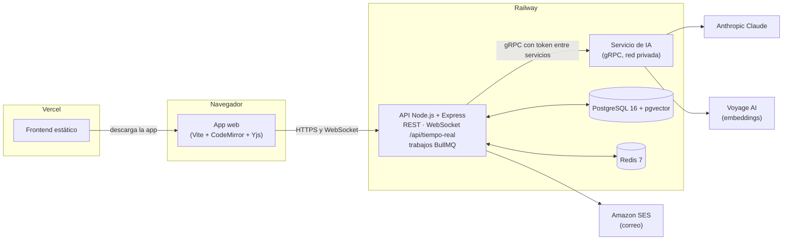
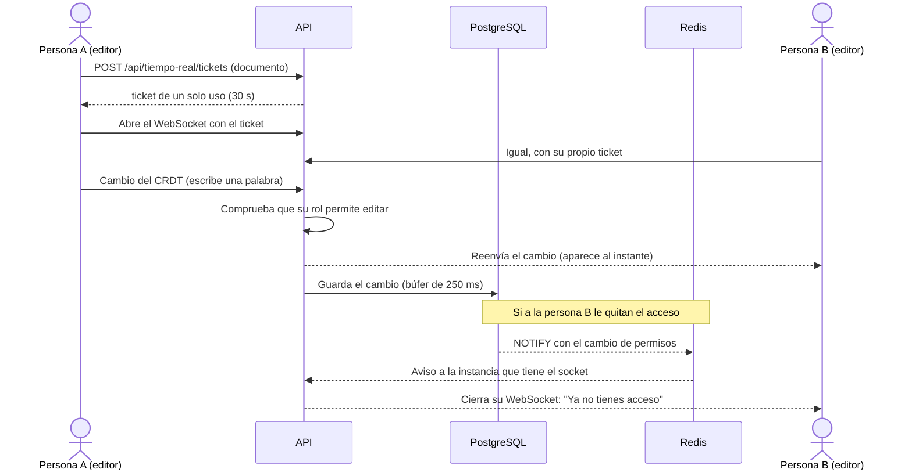

# Cuaderno: editor colaborativo de documentación técnica con IA

**Producción:** aplicación en <https://cuaderno.jonarproyectos.com> · API en
`api-cuaderno.jonarproyectos.com` (estado: [`/ready`](https://api-cuaderno.jonarproyectos.com/ready)).

Este README es la guía para evaluar el proyecto completo sin ayuda. El proyecto vive en tres
repositorios; este (`editor-ia-backend`) es el principal y tiene la guía de pruebas. Los otros dos
explican su parte y enlazan aquí:

| Repositorio          | Qué contiene                                                                                  |
| -------------------- | --------------------------------------------------------------------------------------------- |
| `editor-ia-backend`  | **Este.** API REST, WebSocket de edición en tiempo real y el servicio de IA (gRPC).           |
| `editor-ia-frontend` | La aplicación web: documentos, editor colaborativo, historial, asistente de IA, cuenta y administración. |
| `editor-ia-database` | El esquema de PostgreSQL (migraciones SQL), el usuario de base con privilegios mínimos y sus pruebas. |

## Contenido

1. [Qué es el proyecto](#1-qué-es-el-proyecto)
2. [Cómo funciona](#2-cómo-funciona)
3. [Tecnologías](#3-tecnologías)
4. [Qué necesita el profesor](#4-qué-necesita-el-profesor)
5. [Acceso y roles](#5-acceso-y-roles)
6. [Guía de pruebas función por función](#6-guía-de-pruebas-función-por-función)
7. [Pruebas automatizadas](#7-pruebas-automatizadas)
8. [Limitaciones conocidas y decisiones de diseño](#8-limitaciones-conocidas-y-decisiones-de-diseño)
9. [Solución de problemas](#9-solución-de-problemas)
10. [Estructura del repositorio](#10-estructura-del-repositorio)
11. [Glosario](#11-glosario)

## 1. Qué es el proyecto

**Cuaderno** es un editor de documentación técnica en Markdown donde varias personas escriben el
mismo documento a la vez, como en un procesador de textos en línea. Cada versión guardada queda
encadenada con un hash para poder comprobar que nadie la alteró, y un asistente de IA explica,
resume y mejora el texto, sugiere cómo seguir escribiendo y busca por significado dentro del
espacio de trabajo. Está pensado para equipos pequeños que documentan software juntos; las cuentas
se crean solo por invitación de la administración.

Capacidades principales:

- **Espacios y documentos** con roles: propietario, edición y lectura.
- **Edición colaborativa en tiempo real** con presencia (quién está, su cursor y su selección) y
  edición sin conexión que se sincroniza al volver.
- **Vista previa** de Markdown con fórmulas (KaTeX) y código resaltado, sin ejecutar HTML peligroso.
- **Comentarios** anclados a un tramo del texto, con respuestas y resolución.
- **Historial de versiones** con comparación, restauración y **verificación de la cadena de hash**.
- **Asistente de IA**: explicar, resumir, mejorar (como propuesta), autocompletar mientras escribes
  y búsqueda semántica en el espacio, con topes de uso diarios.
- **Cuentas** por invitación, verificación en dos pasos (obligatoria para administración),
  recuperación de contraseña, sesiones abiertas, foto, exportación y eliminación de la cuenta.

## 2. Cómo funciona

### El recorrido de principio a fin

1. **La administración invita** a una persona con su nombre, su correo y sus permisos. Le llega un
   enlace por correo para **crear su cuenta**; el enlace nunca se muestra en pantalla.
2. **La persona entra** (con verificación en dos pasos si es de administración). Su sesión usa un
   token de acceso que vive solo en memoria y una cookie de renovación que el JavaScript no puede
   leer.
3. **Crea un espacio y un documento.** El editor abre una conexión WebSocket con un ticket de un solo
   uso. Cada tecla viaja como un cambio pequeño de un CRDT (una estructura de datos que permite que
   varias personas editen a la vez y siempre lleguen al mismo texto, sin conflictos), el servidor lo
   reparte a los demás y lo guarda en PostgreSQL.
4. **Si alguien pierde acceso** (lo quitan del espacio, le bajan el rol), la base avisa al servidor y
   este corta o limita su conexión en milisegundos.
5. **Las versiones** se guardan a mano o por restauración; cada una lleva el hash de la anterior, y la
   base lo recalcula al verificar.
6. **La IA** no la llama el navegador: el API habla por **gRPC** con un servicio de IA aparte, que usa
   Anthropic Claude para el texto y Voyage para los embeddings de la búsqueda. Las respuestas largas
   llegan por partes (streaming) y se pueden detener.

### Arquitectura



El DNS está en Cloudflare. La aplicación (`cuaderno.`) y la API (`api-cuaderno.`) son orígenes
distintos del mismo sitio: la cookie de sesión viaja entre los dos, y el API responde con CORS solo
al origen de la aplicación.

### Flujo principal: dos personas editando el mismo documento



Más detalle: el protocolo del WebSocket en
[docs/protocolo-tiempo-real.md](docs/protocolo-tiempo-real.md), las decisiones en
[docs/adr/](docs/adr/), todas las rutas en [docs/referencia-tecnica.md](docs/referencia-tecnica.md)
y el contrato de la API en [docs/openapi.json](docs/openapi.json).

## 3. Tecnologías

Versiones exactas fijadas en el `package.json` de cada repositorio, el `Dockerfile` y el
`docker-compose.yml` de `editor-ia-database`.

| Tecnología                                  | Versión                                  | Para qué se usa                                                           | Por qué se eligió                                                                                                     |
| ------------------------------------------- | ---------------------------------------- | ------------------------------------------------------------------------- | --------------------------------------------------------------------------------------------------------------------- |
| **Node.js**                                 | 24 (mínimo declarado; imagen `node:24-bookworm-slim`) | API y servicio de IA                                         | Un solo lenguaje con el frontend; bueno para muchas conexiones abiertas.                                              |
| **TypeScript**                              | 6.0.3                                    | Lenguaje del backend                                                      | Tipos compartidos entre REST, gRPC y la base.                                                                         |
| **Express**                                 | 5.3.0                                    | API REST                                                                  | Estándar conocido; la versión 5 maneja errores de funciones `async` sin envoltorios.                                 |
| **zod** + **zod-to-openapi**                | 4.6.7 · 9.1.0                            | Validación de entradas y configuración; genera `docs/openapi.json`        | Un solo esquema para validar y documentar; la CI falla si la documentación queda desactualizada.                      |
| **ws**                                      | 8.22.0                                   | WebSocket de edición en tiempo real                                       | Control del ticket en el subprotocolo, del `Origin` y de cada mensaje.                                                |
| **Yjs** + **y-protocols**                   | 13.6.33 · 1.0.7                          | CRDT de los documentos, presencia y sincronización                        | Convergencia garantizada sin servidor de bloqueo y edición sin conexión ([ADR 0003](docs/adr/0003-crdt.md)).          |
| **gRPC** (`@grpc/grpc-js`, proto-loader) y **buf** | 1.14.6 · 0.8.1 · buf 1.73.0      | Comunicación API ↔ servicio de IA (unaria, streaming del servidor, del cliente y bidireccional) | Contrato tipado, streaming, deadlines y cancelación; buf detecta cambios incompatibles ([ADR 0002](docs/adr/0002-comunicacion.md)). |
| **Anthropic Claude** (`@anthropic-ai/sdk`)  | 1.3.0                                    | Explicar, resumir, mejorar y autocompletar                                | Detrás de un proveedor intercambiable; en desarrollo, `AI_PROVIDER=mock`.                                             |
| **Voyage AI**                               | modelo configurable (`VOYAGE_MODEL`)     | Embeddings de 1024 dimensiones para la búsqueda por significado           | El API verifica la dimensión al conectar con el servicio.                                                             |
| **PostgreSQL + pgvector**                   | imagen `pgvector/pgvector:pg16`          | Datos, permisos, cadena de versiones, vectores y avisos (`NOTIFY`)        | Las reglas viven en la base (restricciones, triggers y un usuario con privilegios mínimos).                                     |
| **Prisma** (con `@prisma/adapter-pg`)       | 7.10.0                                   | Cliente tipado de la base                                                 | Solo como cliente; `prisma:check` falla si el esquema se desvía de la base.                                           |
| **Redis** (ioredis) + **BullMQ**            | imagen `redis:7-alpine` · 6.0.0 · 6.3.10 | Límites de uso, tickets, avisos entre instancias, cola de indexado y retención diaria | Estado compartido entre instancias; los límites fallan cerrados.                                         |
| **AWS SDK SES v2** (con **Amazon SES**)     | `@aws-sdk/client-sesv2` 3.1151.0         | Correos: invitaciones, recuperación, cambio de correo y avisos            | API oficial; en desarrollo, `EMAIL_PROVIDER=mock` con un buzón simulado.                                              |
| **helmet** · **pino** · **prom-client**     | 8.3.0 · 10.4.0 · 15.1.3                  | Cabeceras de seguridad, logs JSON sin secretos y métricas Prometheus      | Operación: `/health`, `/ready` y `/metrics`.                                                                          |
| **Vite** · **CodeMirror 6** · **KaTeX** · **highlight.js** (frontend) | 8.3.5 · 6.x · 0.19.0 · 11.12.0 | Build, editor, fórmulas y código resaltado                       | Editor accesible y extensible; KaTeX y highlight.js se cargan solo al usarse.                                         |
| **Vitest** · **Supertest** · **Playwright** · **axe** | 5.0.4 · 7.3.1 · 1.63.0 · 4.13.0 | Pruebas unitarias, de integración, E2E y accesibilidad                | Integración contra la base y Redis reales, en una base de pruebas aparte.                                             |
| **ESLint**                                  | 10.12.0                                  | Reglas del código en los tres repositorios                                | La CI lo exige.                                                                                                       |
| **GitHub Actions** · **gitleaks**           | —                                        | CI: lint, tipos, chequeos de Prisma, OpenAPI y proto, tests, build, mutaciones, `npm audit` y secretos | Nada llega a `main` sin pasar todo.                                        |
| **Docker**                                  | —                                        | Una imagen para el API y el servicio de IA; PostgreSQL y Redis en desarrollo | El mismo artefacto en local y en Railway, sin usuario root.                                                        |
| **Railway** · **Vercel** · **Cloudflare**   | —                                        | API, servicio de IA, PostgreSQL y Redis en Railway; frontend en Vercel; DNS en Cloudflare | HTTPS automático, dominios propios y red privada entre el API y la IA.                                     |

## 4. Qué necesita el profesor

### a) Opción recomendada: solo el navegador

- Un navegador actualizado: **Chrome, Edge o Firefox** de escritorio, con acceso a internet.
- La URL: <https://cuaderno.jonarproyectos.com>. No hay que instalar nada, ni micrófono ni
  altavoces (Cuaderno no tiene funciones de voz).
- **Para la cuenta de administración:** una aplicación de códigos en el teléfono (Google
  Authenticator, Microsoft Authenticator o similar): la verificación en dos pasos es obligatoria
  para ese permiso.
- **Para probar la edición en tiempo real:** dos ventanas lado a lado. Con **una sola cuenta** basta
  abrir el mismo documento en dos pestañas: lo que se escribe en una aparece en la otra. Para ver a
  **dos personas** (presencia con nombres, permisos distintos, revocación en vivo) hacen falta dos
  cuentas que compartan un espacio, una en una ventana normal y otra en una de incógnito (ver
  [Acceso y roles](#5-acceso-y-roles)).
- Para la foto de perfil: una imagen JPEG o PNG.

Comprobación rápida de que todo está en línea: abre
<https://api-cuaderno.jonarproyectos.com/ready>. Debe mostrar
`{"estado":"listo","comprobaciones":{"bd":"ok","esquema":"ok","redis":"ok","ia":"ok"}}`.

### b) Opción local (opcional)

Levanta todo en tu equipo con la IA y el correo **simulados** (no hace falta ninguna clave externa).
Los comandos son para `cmd.exe` en Windows 10 u 11 y se probaron así. La guía paso a paso con todo
el detalle (qué debe aparecer en cada ventana) está en
[docs/guia-demostracion.md](docs/guia-demostracion.md).

**Requisitos:** [Node.js](https://nodejs.org/) **24 o superior**,
[Docker Desktop](https://www.docker.com/products/docker-desktop/) encendido (PostgreSQL, Redis y las
réplicas de Linux corren en contenedores; no hace falta `psql`), [Git](https://git-scm.com/) y los
puertos libres 5435 (PostgreSQL), 6381 (Redis), 4200 (API), 4210 (servicio de IA) y 5175
(frontend).

**1. Clona los tres repositorios en la misma carpeta** (el backend busca el esquema en
`..\editor-ia-database`):

```bat
set RAIZ=C:\cuaderno-demo
mkdir "%RAIZ%"
cd /d "%RAIZ%"
git clone https://github.com/Jonar519/editor-ia-database.git
git clone https://github.com/Jonar519/editor-ia-backend.git
git clone https://github.com/Jonar519/editor-ia-frontend.git
```

**2. Base de datos y Redis:**

```bat
cd /d "%RAIZ%\editor-ia-database"
npm ci
scripts\db-up.bat
scripts\db-migrate.bat dev
```

Esperado: `db-up` crea `.env` con contraseñas locales aleatorias y levanta `cuaderno_postgres` y
`cuaderno_redis`; la migración termina con `Base cuaderno: 23 migraciones aplicadas.`
(`scripts\db-migrate.bat dev --estado` → `23 aplicadas, 0 pendientes`).

**3. API** (deja esta ventana abierta):

```bat
cd /d "%RAIZ%\editor-ia-backend"
npm ci
npm run prisma:generate
npm run proto:generate
scripts\env-init.bat
scripts\bd-preparar.bat
scripts\dev.bat
```

`env-init.bat` crea o completa `.env` con secretos aleatorios propios (nunca cambia un valor que ya
exista); los valores de desarrollo quedan así, por ejemplo:

```ini
APP_URL=http://127.0.0.1:5175
TRUST_PROXY=0
AI_PROVIDER=mock
EMAIL_PROVIDER=mock
GEO_PROVIDER=mock
```

Esperado: el log `Cuaderno API escuchando` en el puerto 4200.

**4. Servicio de IA** (otra ventana; repite `set RAIZ=C:\cuaderno-demo`):

```bat
cd /d "%RAIZ%\editor-ia-backend"
scripts\ia.bat
```

Esperado: `Cuaderno IA escuchando (gRPC)` con `"puerto":4210` y `"proveedor":"mock"`.

**5. Frontend** (otra ventana):

```bat
cd /d "%RAIZ%\editor-ia-frontend"
npm ci
scripts\dev.bat
```

Esperado: `Local: http://127.0.0.1:5175/`. Usa siempre `127.0.0.1`, no `localhost`: el API compara
el origen con `APP_URL`.

**6. Comprueba que funciona y crea la primera cuenta** (en una cuarta ventana):

```bat
cd /d "%RAIZ%\editor-ia-backend"
curl -s http://127.0.0.1:4200/ready
scripts\invitar.bat --correo marta.demo@example.com --nombre "Marta Ficticia" --rol admin
scripts\buzon.bat marta.demo@example.com
```

Esperado: `/ready` con todo en `ok`; `invitar` dice que el enlace se envió al correo (no lo muestra);
`buzon` (el correo simulado) muestra el enlace `http://127.0.0.1:5175/#/invitacion/…`. Ábrelo, elige
una contraseña de 12 caracteres o más y escribe el código de tu app autenticadora (sin app:
`scripts\totp.bat <secreto sin espacios>`). Después sigue la
[guía de pruebas](#6-guía-de-pruebas-función-por-función); en local, los correos se leen con
`scripts\buzon.bat <correo>` y la IA simulada responde con textos fijos.

Para detener todo: **Ctrl+C** en cada ventana y `scripts\db-down.bat` en `editor-ia-database`.

## 5. Acceso y roles

### Roles

Hay dos niveles. El **permiso de la cuenta** (lo elige la administración al invitar) pone el techo; el
**rol en cada espacio** decide qué puede hacer ahí, sin superar ese techo.

| Permiso de la cuenta | Qué puede hacer                                                                                                                                            |
| -------------------- | ---------------------------------------------------------------------------------------------------------------------------------------------------------- |
| **Lectura**          | Ver los documentos de los espacios donde es miembro, comentar, ver el historial y usar Explicar y Resumir de la IA. No crea espacios ni edita.             |
| **Edición**          | Además, crear espacios y documentos, editar, guardar y restaurar versiones, Mejorar con la IA, las sugerencias al escribir y el índice de búsqueda.       |
| **Administración**   | Además, invitar personas y administrar las invitaciones (**Administración**). Verificación en dos pasos obligatoria.                                       |

| Rol en un espacio  | Qué significa                                                                                                                         |
| ------------------ | ------------------------------------------------------------------------------------------------------------------------------------- |
| **Propietario**    | Quien lo creó: agrega y quita miembros, cambia sus roles, transfiere el espacio y lo borra (solo si es el único miembro).                                               |
| **Edición**        | Crea y edita documentos del espacio. Quien crea un documento es su propietario (ser dueño del espacio no da la propiedad del documento). |
| **Lectura**        | Solo lee (y comenta). Una cuenta de Lectura nunca puede tener un rol mayor: la base lo impide.                                        |

Agregar miembros a un espacio, transferir la propiedad y dar permisos por documento se hace **por la
API** (no tienen pantalla); ver la [referencia técnica](docs/referencia-tecnica.md#api). Sin acceso a
un documento la API responde 404 (no revela que existe); con acceso pero sin el rol, 403.

### Credenciales

Las credenciales **no** están en este README. El estudiante las entrega por un canal privado, o envía
una **invitación por correo** a la dirección del profesor, idealmente dos (una de Administración y
otra de Lectura o Edición) y un espacio compartido entre ellas para probar la colaboración y los
permisos:

<!-- ACCESO: lo completa el estudiante -->

- **Invitación por correo:** trae un enlace a **Crear tu cuenta** ("Hola, …. Te invitaron con permisos
  de …"). Eliges tu contraseña (12 caracteres o más; una frase sirve). Si la invitación es de
  Administración, en la misma pantalla aparece el secreto para tu app de códigos y pide el código de
  6 dígitos; al crear la cuenta se muestran **10 códigos de respaldo** una sola vez.
- **Vence a las 72 horas** y sirve una sola vez. En la pantalla de administración, una vencida dice
  **Venció: hay que reenviarla**: pide al estudiante que pulse **Reenviar** (llega un enlace nuevo y el
  anterior deja de servir).
- **Si no llega el correo:** revisa spam. El servicio de correo está en modo de pruebas y solo
  entrega a direcciones verificadas por el estudiante (ver
  [Limitaciones](#8-limitaciones-conocidas-y-decisiones-de-diseño)).

### Verificación en dos pasos

- **Administración: obligatoria** y no se puede desactivar.
- **Edición y Lectura: opcional**, en **Tu cuenta → Verificación en dos pasos**.
- Al entrar, después de la contraseña se pide el código de la app; con **Usar un código de respaldo**
  se usa uno de los 10 códigos, que sirve una sola vez.

### Si algo del acceso falla

| Situación                                      | Qué hacer                                                                                                                                                      |
| ---------------------------------------------- | -------------------------------------------------------------------------------------------------------------------------------------------------------------- |
| Olvidaste la contraseña                        | En **Entrar**, **¿Olvidaste tu contraseña?** → tu correo → **Enviar el enlace**. El mensaje es el mismo exista o no la cuenta; el enlace vence en 15 minutos y al usarlo se cierran todas tus sesiones. |
| El código no es válido                         | Revisa que la hora del teléfono sea automática, o usa un código de respaldo.                                                                                   |
| Perdiste el teléfono y los códigos de respaldo | La app no permite recuperar la verificación en dos pasos (a propósito). Avisa al estudiante.                                                                   |
| La sesión se cerró sola                        | El acceso dura 15 minutos y se renueva solo mientras usas la app. Si se cerraron tus sesiones desde **Sesiones abiertas** o cambiaste la contraseña, vuelve a entrar. |
| "Demasiadas solicitudes"                        | Hay límites por ruta sensible (inicio de sesión, verificación, recuperación…). Espera un minuto y vuelve a intentar.                                           |

## 6. Guía de pruebas función por función

Un recorrido de unos **25 minutos** en producción, en este orden. La columna **Depende de** indica
si la función usa un servicio externo (si ese servicio falla, la función puede fallar sin que sea un
error del proyecto); "No" significa que solo usa la API, la base y Redis propios.

**Preparación:** ventana A (normal) con la cuenta de administración. Si tienes una segunda cuenta,
ventana B (incógnito) con ella. Si no, la ventana B es otra pestaña con la misma cuenta.

### A. Portada y apariencia (1 min)

| Función              | Qué hace                                                       | Pasos para probarla                                                                                 | Resultado esperado                                                                                                                     | Depende de |
| -------------------- | -------------------------------------------------------------- | --------------------------------------------------------------------------------------------------- | -------------------------------------------------------------------------------------------------------------------------------------- | ---------- |
| A1. Portada          | Presenta el producto y la única entrada                         | Abre <https://cuaderno.jonarproyectos.com>                                                          | "Documentación técnica escrita en equipo.", tres frases de lo que hace, el botón **Entrar** y "Las cuentas se crean solo por invitación de la administración." | No         |
| A2. Tema del sistema | Toda la app sigue el modo claro u oscuro del sistema operativo | Cambia el modo del sistema (Windows: Configuración → Personalización → Colores) con la app abierta | Cambia de tema al instante, sin recargar.                                                                                             | No         |
| A3. Teclado          | Navegación accesible                                           | Recarga y pulsa Tab                                                                                 | El primer foco es **Saltar al contenido** y el foco siempre se ve.                                                                    | No         |

### B. Entrar y administración (3 min)

| Función                          | Qué hace                                                          | Pasos para probarla                                                                                                                                       | Resultado esperado                                                                                                                                                  | Depende de   |
| -------------------------------- | ----------------------------------------------------------------- | --------------------------------------------------------------------------------------------------------------------------------------------------------- | ------------------------------------------------------------------------------------------------------------------------------------------------------------------- | ------------ |
| B1. Entrar con dos pasos         | Contraseña y código de la app                                      | **Entrar** → correo y contraseña → código de 6 dígitos                                                                                                    | Llegas a **Documentos**. Recarga (F5): la sesión sigue (se renovó con la cookie).                                                                                   | No           |
| B2. Código de respaldo           | Entrar sin el teléfono, una sola vez por código                   | Pulsa **Salir** (arriba) y entra eligiendo **Usar un código de respaldo**; luego repite con el mismo código                                                | La primera vez entras; la segunda, el código ya no es válido.                                                                                                       | No           |
| B3. Invitar a una persona        | Única forma de crear cuentas                                       | **Administración** → **Invitar a una persona** → nombre, un correo tuyo verificado por el estudiante y **Permisos** (Lectura, Edición o Administración) → **Enviar la invitación** | Aparece en **Invitaciones pendientes** con su vencimiento (72 horas). El enlace no se muestra en pantalla: llega solo al correo.                                      | Correo (SES) |
| B4. Reenviar o cancelar          | Enlace nuevo / invitación anulada                                  | En la invitación pendiente: **Reenviar**, o **Cancelar la invitación** → **Sí, cancelarla**                                                                | Reenviar: llega un enlace nuevo y el anterior deja de servir. Cancelar: desaparece de la lista. Un correo ya usado: "Ya hay una cuenta o una invitación con ese correo." | Correo (SES) |
| B5. Crear la cuenta invitada     | La persona elige su contraseña                                     | Abre el enlace del correo en la ventana B                                                                                                                 | **Crear tu cuenta** con "Hola, …. Te invitaron con permisos de …"; el token desaparece de la barra de direcciones al leerlo. Tras **Crear la cuenta**, entra a **Documentos**. | Correo (SES) |

### C. Espacios y documentos (2 min)

| Función                     | Qué hace                                      | Pasos para probarla                                                                             | Resultado esperado                                                                                                                               | Depende de |
| --------------------------- | --------------------------------------------- | ----------------------------------------------------------------------------------------------- | ------------------------------------------------------------------------------------------------------------------------------------------------ | ---------- |
| C1. Crear un espacio        | Agrupa documentos y miembros                  | En **Documentos**, **Nuevo espacio** → "Espacio de prueba" → **Crear espacio**                  | Aparece con "Tu rol: Propietario", el buscador **Buscar por significado** y "Este espacio todavía no tiene documentos."                         | No         |
| C2. Crear un documento      | Abre el editor del documento nuevo            | **Nuevo documento en Espacio de prueba** → "Guía de despliegue" → **Crear documento**           | Se abre el editor con "Conexión: Conectado. Los cambios llegan al momento." y **Aquí ahora** con tu nombre.                                     | No         |
| C3. Permisos en la interfaz | La pantalla oculta lo que tu rol no permite   | Con una cuenta de **Lectura** (si la tienes), abre un documento de un espacio compartido        | Se abre la lectura: sin **Editar**, y la IA solo ofrece Explicar y Resumir. La API respondería 403 si se intentara igual.                         | No         |

### D. Editor y vista previa (4 min)

| Función                         | Qué hace                                                     | Pasos para probarla                                                                                                   | Resultado esperado                                                                                                                                 | Depende de |
| ------------------------------- | ------------------------------------------------------------ | --------------------------------------------------------------------------------------------------------------------- | -------------------------------------------------------------------------------------------------------------------------------------------------- | ---------- |
| D1. Escribir en Markdown        | Editor con atajos                                            | Escribe un título con `# ` y un párrafo; selecciona una palabra y pulsa **Ctrl+B**                                     | El texto se formatea como Markdown (la negrita queda entre `**`).                                                                                  | No         |
| D2. Paleta y menú de bloques    | Comandos sin ratón                                           | **Ctrl+K**, elige un comando con las flechas y Enter. Al principio de una línea escribe `/`                           | La paleta aplica el comando; `/` abre el menú para insertar títulos, listas, tablas o código.                                                      | No         |
| D3. Deshacer solo lo propio     | Ctrl+Z no deshace lo de otra persona                         | Con dos ventanas escribiendo, pulsa **Ctrl+Z** en una                                                                 | Solo se deshace lo que escribió esa ventana.                                                                                                       | No         |
| D4. Vista previa con fórmulas y código | Renderiza KaTeX y código resaltado                    | Escribe `$E = mc^2$` y un bloque de código con ` ```js `; pulsa **Vista previa**                                     | La fórmula y el código resaltado aparecen. KaTeX y highlight.js se descargan solo en ese momento (F12 → Red).                                      | No         |
| D5. Vista previa segura         | El HTML del documento no se ejecuta                          | Escribe `` y `[enlace](javascript:alert(1))`; mira la vista previa                       | El HTML se ve como texto y el enlace no lleva a `javascript:`. No aparece ninguna alerta.                                                          | No         |

### E. Tiempo real (4 min)

| Función                            | Qué hace                                                          | Pasos para probarla                                                                                                                                    | Resultado esperado                                                                                                                                               | Depende de |
| ---------------------------------- | ----------------------------------------------------------------- | ------------------------------------------------------------------------------------------------------------------------------------------------------ | ---------------------------------------------------------------------------------------------------------------------------------------------------------------- | ---------- |
| E1. Edición simultánea             | Lo que escribe uno aparece en el otro                             | Abre el mismo documento en las ventanas A y B (**Editar**) y escribe en una                                                                            | El texto aparece en la otra al instante, sin recargar.                                                                                                          | No         |
| E2. Presencia                      | Quién está, con su cursor y su selección                          | Con dos cuentas distintas en el mismo documento (requiere un espacio compartido)                                                                       | **Aquí ahora** muestra los dos nombres, cada uno con su color; el cursor y la selección del otro llevan su nombre.                                               | No         |
| E3. Sin conexión                   | Se puede seguir escribiendo y se sincroniza al volver              | En la ventana B: F12 → **Red** → **Sin conexión**. Escribe una línea. Quita "Sin conexión"                                                             | Aparece "Sin conexión. Reintentando… Puedes seguir: lo que escribas se envía al volver la conexión." Al volver, lo escrito llega a la ventana A **una sola vez**. | No         |
| E4. Revocación en vivo (opcional)  | Quien pierde el acceso deja de poder editar al instante           | Requiere que el propietario del espacio quite a la otra cuenta o le baje el rol por la API, con las dos ventanas abiertas en el documento              | En la ventana de la persona quitada: "Ya no tienes acceso a este documento." y el editor queda de solo lectura; si solo le bajan a Lectura, "Solo puedes leer este documento". | No         |

### F. Comentarios (2 min)

| Función                     | Qué hace                                          | Pasos para probarla                                                                                              | Resultado esperado                                                                                                     | Depende de |
| --------------------------- | ------------------------------------------------- | ---------------------------------------------------------------------------------------------------------------- | ---------------------------------------------------------------------------------------------------------------------- | ---------- |
| F1. Comentar un tramo       | Hilo anclado al texto                             | Selecciona un tramo → **Comentar la selección** → escribe → **Comentar**                                         | El comentario aparece marcando ese tramo; en la otra ventana aparece sin recargar.                                     | No         |
| F2. El ancla se mantiene    | El comentario sigue al texto aunque cambie        | Escribe texto **antes** del tramo comentado                                                                      | El comentario sigue marcando el mismo tramo.                                                                           | No         |
| F3. Responder, editar, resolver y borrar | Ciclo de vida del hilo               | En el comentario: **Responder**, **Editar**, **Resolver** (y **Reabrir**), **Borrar**; marca **Mostrar resueltos** | Cada acción se refleja al instante; los resueltos se ocultan salvo con **Mostrar resueltos**.                          | No         |

### G. Historial de versiones (3 min)

| Función                     | Qué hace                                                    | Pasos para probarla                                                                                             | Resultado esperado                                                                                                                     | Depende de |
| --------------------------- | ----------------------------------------------------------- | --------------------------------------------------------------------------------------------------------------- | -------------------------------------------------------------------------------------------------------------------------------------- | ---------- |
| G1. Guardar versiones       | Fotografía del documento                                    | **Historial de versiones** → **Guardar una versión ahora**; cambia el texto en el editor y guarda otra          | "Listo: Guardaste la versión 1." y luego la 2, cada una con autor y fecha.                                                            | No         |
| G2. Comparar                | Diferencia por líneas                                       | Elige **Desde** la versión 1 y **Hasta** el texto actual → **Comparar**                                        | Las líneas agregadas y quitadas con + y −, y también con texto (no solo color). Se calcula en un Web Worker.                         | No         |
| G3. Restaurar               | Vuelve a una versión como un cambio nuevo                   | **Restaurar** en la versión 1                                                                                    | El texto vuelve a la versión 1 en el editor (también en la otra ventana) y el historial suma una versión de restauración, sin borrar nada. | No         |
| G4. Verificar la cadena     | Comprueba que ninguna versión se alteró                      | **Verificar la cadena**                                                                                          | "Listo: La cadena está íntegra: N versiones verificadas." La base recalcula los hashes.                                               | No         |

### H. Asistente de IA (4 min)

En el editor, botón **IA**. Las respuestas las genera Claude: el texto exacto cambia cada vez.

| Función                              | Qué hace                                                        | Pasos para probarla                                                                                                     | Resultado esperado                                                                                                                                            | Depende de           |
| ------------------------------------ | --------------------------------------------------------------- | ----------------------------------------------------------------------------------------------------------------------- | ------------------------------------------------------------------------------------------------------------------------------------------------------------- | -------------------- |
| H1. Explicar la selección            | Respuesta corta sobre el fragmento                               | Selecciona un párrafo → **Explicar la selección**                                                                       | Llega una explicación del fragmento. Aviso visible: las respuestas pueden contener errores.                                                                   | IA (Claude)          |
| H2. Resumir y detener                | Respuesta por partes que se puede cortar                         | **Resumir el documento**; mientras llega, pulsa **Detener**                                                             | El resumen aparece por partes (streaming) y se corta al detenerlo.                                                                                           | IA (Claude)          |
| H3. Mejorar la selección             | Propuesta que nunca se aplica sola                               | Selecciona un párrafo, elige un **Estilo** (más claro, más breve o más formal) → **Mejorar la selección**               | Aparece una propuesta con **Reemplazar selección**, **Insertar debajo** y **Descartar**. El documento no cambia hasta que elijas.                             | IA (Claude)          |
| H4. Sugerencias mientras escribes    | Autocompletado con texto fantasma                                | Activa **Sugerencias de la IA mientras escribes** y escribe una frase incompleta; espera                                | Aparece texto fantasma: **Tab** lo acepta y **Escape** lo descarta. Están desactivadas al abrir el documento.                                                 | IA (Claude)          |
| H5. Búsqueda por significado         | Encuentra fragmentos por su sentido, no por palabras exactas     | **Actualizar índice de búsqueda**; en **Documentos**, escribe en **Buscar por significado** una idea del documento → **Buscar** | Fragmentos del documento, como texto. Solo busca en ese espacio y en documentos a los que tienes acceso hoy. (El documento también se indexa solo 5 minutos después de dejar de editarlo.) | IA (Voyage)          |
| H6. Topes de uso                     | Límite diario por cuenta                                         | Mira el pie del panel de IA                                                                                             | "Hoy: N de 300 pedidos de IA." Al llegar al tope, la IA responde con un aviso y cuándo se renueva.                                                           | No                   |

### I. Tu cuenta (3 min)

Arriba, **Tu cuenta**.

| Función                        | Qué hace                                                    | Pasos para probarla                                                                                     | Resultado esperado                                                                                                                                 | Depende de   |
| ------------------------------ | ----------------------------------------------------------- | ------------------------------------------------------------------------------------------------------- | -------------------------------------------------------------------------------------------------------------------------------------------------- | ------------ |
| I1. Perfil                     | Nombre y teléfono                                           | Cambia el teléfono → **Guardar los cambios**                                                            | "Guardamos tus cambios."                                                                                                                           | No           |
| I2. Foto de perfil             | Recorte en el navegador y limpieza de metadatos             | **Agregar una foto** → **Elegir una imagen** (JPEG o PNG) → encuadra → **Guardar la foto**              | "Guardamos tu foto nueva." El servidor la guarda sin metadatos (por ejemplo, sin la ubicación GPS de una foto de teléfono).                        | No           |
| I3. Cambiar el correo          | Confirma la dirección nueva por correo                      | **Cambiar el correo** → correo nuevo y tu contraseña                                                    | Llega un enlace al correo nuevo y un aviso al anterior; el cambio aplica al abrir el enlace.                                                       | Correo (SES) |
| I4. Cambiar la contraseña      | Pide la actual                                               | **Cambiar la contraseña** → actual y nueva                                                              | Confirmación; las demás sesiones se cierran.                                                                                                      | No           |
| I5. Verificación en dos pasos  | Activar (Edición y Lectura) y regenerar códigos              | **Verificación en dos pasos**: actívala con el código de la app, o regenera los **Códigos de respaldo** | Se activa y entrega 10 códigos de respaldo. En una cuenta de Administración no hay opción de desactivarla.                                        | No           |
| I6. Sesiones abiertas          | Ver y cerrar sesiones en otros dispositivos                  | Entra con la misma cuenta en otro navegador; en el primero, **Sesiones abiertas**                      | Cada sesión con navegador, **Ubicación aproximada** y fechas; la actual dice **Este dispositivo**. **Cerrar todas las demás** saca al otro navegador. | No           |
| I7. Descargar mis datos        | Exporta lo que el sistema guarda de ti                       | **Tus datos** → **Descargar mis datos** (pide la contraseña)                                            | Se descarga un JSON sin secretos.                                                                                                                  | No           |
| I8. Eliminar la cuenta         | Borra la cuenta (deja una lápida)                            | **Eliminar mi cuenta** → contraseña (y código si tiene dos pasos) → marca «Entiendo que no se puede deshacer» | Si eres propietario de algo compartido, explica qué hay que transferir antes. **No lo hagas con una cuenta que necesites.**                       | No           |

### J. Robustez y seguridad (2 min, opcional)

| Función                          | Qué hace                                               | Pasos para probarla                                                                 | Resultado esperado                                                                                                     | Depende de |
| -------------------------------- | ------------------------------------------------------ | ----------------------------------------------------------------------------------- | ---------------------------------------------------------------------------------------------------------------------- | ---------- |
| J1. Carga sin conexión           | El Service Worker guarda el armazón de la app          | Con la app abierta, F12 → **Red** → **Sin conexión** → recarga                      | Carga el armazón desde la caché; nada de `/api` sale de la caché.                                                     | No         |
| J2. Ningún token en el navegador | La sesión vive en memoria y en una cookie httpOnly     | F12 → **Aplicación** → almacenamiento local y de sesión                              | Vacíos de tokens.                                                                                                      | No         |
| J3. WebSocket del documento      | Tiempo real por `wss://api-cuaderno…`                  | F12 → **Red** → filtro **WS** con un documento abierto                              | Una conexión a `wss://api-cuaderno.jonarproyectos.com/api/tiempo-real`; el ticket va en el subprotocolo, no en la URL. | No         |
| J4. Salud del servicio           | Sondas de la plataforma                                | Abre <https://api-cuaderno.jonarproyectos.com/health> y `/ready`                    | `{"estado":"ok"}` y `/ready` con bd, esquema, redis e ia en `ok` (la IA es informativa: si falla, `/ready` sigue en 200). | No         |

### Funciones sin pantalla (se evalúan por los tests o la documentación)

| Función                                                                 | Dónde está                                                         | Cómo se comprueba                                                                                                         |
| ----------------------------------------------------------------------- | ------------------------------------------------------------------ | ------------------------------------------------------------------------------------------------------------------------- |
| Miembros de un espacio, transferir espacios y documentos, permisos por documento, renombrar y borrar | `/api/espacios/{id}/miembros`, `/propiedad`, `/api/documentos/{id}/permisos` | [docs/demo-K1.md](docs/demo-K1.md) y los tests de integración                                                              |
| Verificación de la cadena por la API y su manipulación en la base       | `GET /api/documentos/{id}/versiones/verificacion`                  | [Guía de demostración, bloque R](docs/guia-demostracion.md#bloque-r-cierre)                                               |
| Retención diaria (03:15 UTC) y purga                                    | Trabajo BullMQ que llama a `purgar_retencion()`                    | [docs/data-retention.md](docs/data-retention.md)                                                                          |
| Auditoría de seguridad (inicios de sesión, MFA, recuperación…)          | Tabla `eventos_seguridad` (IP truncada, nunca tokens)              | [Guía de demostración, bloque F](docs/guia-demostracion.md#bloque-f-mfa-recuperación-y-auditoría)                         |
| Límites por ruta y general (600 pedidos por minuto y cuenta)            | Redis; fallan cerrados (503)                                       | Tests de integración                                                                                                      |
| gRPC: los cuatro tipos de llamada, token entre servicios, deadlines y cancelación | `proto/`, `src/ia/`                                      | [Guía de demostración, bloque P1](docs/guia-demostracion.md#bloque-p1-grpc) · `npm run proto:check`                        |
| Métricas Prometheus                                                     | `GET /metrics` con token                                           | Tests de integración                                                                                                      |
| CLI de operador: invitar, reindexar, buzón simulado, TOTP               | `scripts/`                                                         | [Referencia técnica: scripts](docs/referencia-tecnica.md#scripts)                                                         |

## 7. Pruebas automatizadas

Necesitan la opción local (Docker con los servicios de `editor-ia-database`). Las pruebas usan
siempre la base `cuaderno_test` y la db 1 de Redis, nunca la de desarrollo. En cada repositorio,
`scripts\ci.bat` corre los mismos pasos que la CI y muestra el código de salida de cada uno.

| Repositorio          | Comando                                   | Qué cubre                                                                                                                                                                                                 | Resultado esperado                                                                     |
| -------------------- | ----------------------------------------- | --------------------------------------------------------------------------------------------------------------------------------------------------------------------------------------------------------- | -------------------------------------------------------------------------------------- |
| `editor-ia-backend`  | `scripts\test.bat`                        | Unitarias y de integración con Supertest contra la base y Redis reales: sesión, MFA, invitaciones, cuenta, espacios y permisos, tiempo real con sockets reales, convergencia del CRDT, versiones, comentarios, IA por gRPC real, inyección de prompts, topes, retención, OpenAPI | `Tests 563 passed (563)` en 50 archivos.                                                |
| `editor-ia-backend`  | `scripts\ci.bat`                          | Además: `proto:generate`, lint, typecheck, `prisma:check` (el esquema no se desvía), `openapi:check`, `proto:check` (buf lint y breaking), build, **256 mutaciones**, `npm audit` y gitleaks | `RESULTADO: OK`.                                                                        |
| `editor-ia-frontend` | `scripts\ci.bat`                          | Lint, typecheck, 432 pruebas unitarias, auditoría de color y contraste (128 pares AA en los dos temas), build, presupuestos de peso, **128 mutaciones**, `npm audit`, **E2E en Linux** (Playwright + axe, 223 pruebas) y gitleaks | `RESULTADO: OK` y `Detectadas 128, sobreviven 0`.                                       |
| `editor-ia-database` | `scripts\ci.bat` | Lint, typecheck, 74 pruebas unitarias, **198 pruebas SQL** sobre la base de pruebas (reglas, aislamiento, cadena de versiones, retención, privilegios del usuario de la app), **173 mutaciones**, `npm audit` y gitleaks | `Pruebas SQL: 198 OK, 0 fallidas` y `RESULTADO: OK`. |

La **CI** (GitHub Actions) corre todo esto en cada `push`. Hay además mediciones con sus informes
(cada una dice primero lo que no permite concluir): gRPC frente a REST/JSON
([docs/medicion-p3.md](docs/medicion-p3.md)), carga HTTP y WebSocket ([docs/carga-r.md](docs/carga-r.md)) y
almacenamiento de versiones ([docs/almacenamiento-r.md](docs/almacenamiento-r.md)).

> **Problema conocido en Windows:** muy de vez en cuando, con la CPU saturada, el proceso de Vitest
> termina con `exit code 3221226505` y sin ninguna prueba fallida. Se repite la corrida; en Linux
> nunca se vio ([detalle](docs/referencia-tecnica.md#problema-conocido-el-trabajador-de-vitest-muere-en-windows-con-la-cpu-saturada)).

## 8. Limitaciones conocidas y decisiones de diseño

- **Correo en modo de pruebas.** Amazon SES está en modo _sandbox_: solo entrega a direcciones
  verificadas por el estudiante. Invitaciones, recuperación de contraseña y cambio de correo solo
  llegan a esas direcciones.
- **Miembros y permisos solo por la API.** Agregar o quitar miembros de un espacio, transferir la
  propiedad y dar permisos por documento no tienen pantalla: se hacen con la API (y así lo prueba la
  guía de demostración). Por eso, para probar la colaboración entre dos cuentas, el estudiante prepara
  el espacio compartido.
- **Cuotas de IA.** Por cuenta y por día: 300 pedidos y 300 000 tokens; el indexado automático de cada
  espacio tiene su propio presupuesto diario. Al llegar al tope, la IA lo dice y cuándo se renueva.
- **Respuestas de la IA no deterministas.** En producción las genera Claude: el texto cambia de una vez
  a otra. Lo que no cambia son las reglas (qué ve la IA, quién puede usar qué). El umbral de la
  búsqueda por significado (`IA_SIMILITUD_MINIMA`) no está calibrado con datos reales.
- **La IA es un servicio aparte.** Si el servicio de IA cae, el resto de Cuaderno sigue funcionando:
  `/ready` muestra `"ia":"falla"` sin dejar de responder 200 y la interfaz dice que la IA no está
  disponible.
- **Ubicación de las sesiones.** Se estima con una tabla local de rangos de IP, nunca con un servicio
  externo; si la tabla no tiene el rango, la ubicación aparece como desconocida.
- **Límite de versiones.** Guardar versiones tiene un límite por hora (contra el crecimiento del
  almacenamiento; ver [docs/almacenamiento-r.md](docs/almacenamiento-r.md)).
- **Sin registro público, sin desactivar la MFA de administración y sin voz:** decisiones de diseño.
- **Eliminar una cuenta deja una lápida:** la cuenta conserva su id (para la autoría) y pierde correo,
  nombre, teléfono y contraseña; así el historial y la cadena de hash siguen verificándose ([docs/data-retention.md](docs/data-retention.md)).

## 9. Solución de problemas

| Síntoma                                                 | Qué hacer                                                                                                                                                                         |
| ------------------------------------------------------- | --------------------------------------------------------------------------------------------------------------------------------------------------------------------------------- |
| La página no carga                                      | Abre <https://api-cuaderno.jonarproyectos.com/ready>. Si no responde, avisa al estudiante. Si responde, recarga con Ctrl+F5 o prueba en incógnito.                               |
| "Conexión: Sin conexión. Reintentando…" que no se va     | Revisa tu conexión; si una red corporativa bloquea WebSockets, prueba otra. Lo que escribas se guarda en el navegador y se envía al volver.                                      |
| La sesión expiró o vuelve a **Entrar**                  | Vuelve a entrar. Pasa si cerraste las sesiones desde **Sesiones abiertas**, cambiaste la contraseña o pasó mucho tiempo sin usarla.                                               |
| No llega el correo                                      | Revisa spam. Solo llega a direcciones verificadas ([Limitaciones](#8-limitaciones-conocidas-y-decisiones-de-diseño)). Pide al estudiante un **Reenviar**.                          |
| La invitación dice que no es válida                     | Venció (72 h), ya se usó o se reenvió otra. Pide una nueva.                                                                                                                      |
| La IA dice que no está disponible                       | Mira `/ready`: si `ia` dice `falla`, el servicio de IA está caído o reiniciando; el resto de la app sigue funcionando. Vuelve a intentar en un minuto.                            |
| La IA dice que llegaste al tope                         | Es la cuota diaria de la cuenta (300 pedidos). Se renueva al día siguiente.                                                                                                      |
| La búsqueda por significado no encuentra nada           | El documento no está indexado todavía: **IA → Actualizar índice de búsqueda** (o espera 5 minutos después de editar).                                                             |
| No aparece **Editar** o **Mejorar**                     | Tu cuenta o tu rol en ese espacio es de Lectura.                                                                                                                                  |
| "Demasiadas solicitudes"                                | Límite de uso: espera los segundos que indica el mensaje.                                                                                                                         |
| Local: `Configuración inválida` al arrancar             | El mensaje lista qué variable falta o es inválida. `scripts\env-init.bat` completa las que falten sin tocar las demás (por ejemplo, `TRUST_PROXY` debe ser un número, `0` en local). |
| Local: el API rechaza el origen                         | Usa `http://127.0.0.1:5175`, no `localhost` (debe coincidir con `APP_URL`).                                                                                                       |
| Local: `/ready` muestra `"ia":"falla"`                  | Falta la ventana de `scripts\ia.bat`, o el API y la IA no comparten el mismo `IA_SERVICE_TOKEN` del `.env`.                                                                      |
| Local: no llega ningún correo                           | En local no se envían: `scripts\buzon.bat <correo>` muestra el buzón simulado.                                                                                                    |
| Local: `retencion.test.ts` falla con `statement timeout` | La base `cuaderno_test` acumuló datos de muchas corridas y la purga pasa de 5 s. Con una base de pruebas nueva pasa: define `CUADERNO_TEST_DB` y `TEST_DATABASE_URL` con otra base terminada en `_test`, prepárala con `node scripts/bd-preparar.mjs` y vuelve a correr. |

## 10. Estructura del repositorio

```
editor-ia-backend/
├── src/
│   ├── servidor.ts · app.ts · apagado.ts  # arranque, middlewares y apagado ordenado
│   ├── config/            # variables validadas con zod y negativas de producción
│   ├── http/              # CORS, cookies, errores, salud (/health, /ready)
│   ├── auth/ · invitaciones/ · cuenta/ · usuarios/   # sesión, MFA, recuperación, invitaciones y cuenta
│   ├── espacios/ · documentos/ · versiones/ · comentarios/ · contenido/   # dominio del editor
│   ├── tiempo-real/       # WebSocket: tickets, guardia por mensaje, avisos de la base, compactación
│   ├── ia/                # servicio de IA gRPC (proveedores, prompts, embeddings) y su cliente
│   ├── correo/ · geo/ · imagen/   # proveedores intercambiables y limpieza de imágenes
│   ├── trabajos/          # retención diaria (BullMQ)
│   ├── observabilidad/ · infra/   # métricas, logs, Prisma y Redis
│   └── generated/         # cliente de Prisma y tipos del contrato gRPC (generados)
├── proto/                 # contrato gRPC (cuaderno/ia/v1/ia.proto)
├── prisma/                # schema.prisma (sale de db pull; el esquema lo manda editor-ia-database)
├── tests/unitarias · tests/integracion
├── mutations/             # catálogo de mutaciones
├── scripts/               # dev, ia, test, ci, invitar, buzón, totp, medir, carga, gitleaks…
├── docs/                  # referencia técnica, guía de demostración, ADR, amenazas, protocolo, OpenAPI, mediciones
└── Dockerfile
```

Los otros repositorios describen su estructura en su propio README:
[editor-ia-frontend](https://github.com/Jonar519/editor-ia-frontend#readme) y
[editor-ia-database](https://github.com/Jonar519/editor-ia-database#readme).

## 11. Glosario

| Término                      | Qué significa aquí                                                                                                                  |
| ---------------------------- | ----------------------------------------------------------------------------------------------------------------------------------- |
| **API REST**                 | Las direcciones del servidor (`/api/...`) que la app llama con métodos HTTP y que responden JSON.                                   |
| **WebSocket**                | Conexión abierta para enviar y recibir cambios al instante; aquí, una por documento abierto.                                        |
| **Ticket**                   | Credencial de un solo uso (30 s) para abrir el WebSocket; viaja en el subprotocolo, nunca en la URL.                                |
| **CRDT / Yjs**               | Estructura de datos que permite que varias personas editen a la vez y siempre lleguen al mismo texto; Yjs es la implementación.     |
| **gRPC**                     | Forma de comunicación entre servicios con un contrato tipado (`.proto`) y streaming en los dos sentidos; aquí, entre el API y la IA. |
| **Streaming / SSE**          | La respuesta llega por partes mientras se genera; en el navegador, con eventos enviados por el servidor sobre `fetch`.               |
| **Embedding**                | Lista de números que representa el significado de un texto; textos parecidos tienen embeddings cercanos.                            |
| **pgvector**                 | Extensión de PostgreSQL que guarda embeddings y busca los más cercanos.                                                             |
| **Búsqueda por significado** | Buscar fragmentos por lo que quieren decir, comparando embeddings, en vez de por palabras exactas.                                  |
| **Inyección de prompts**     | Texto dentro del documento que intenta darle órdenes a la IA; aquí el contenido va escapado y separado de las instrucciones.         |
| **Cadena de hash**           | Cada versión guarda el hash de la anterior: alterar una rompe la cadena y la verificación lo detecta.                                |
| **MFA / verificación en dos pasos** | Además de la contraseña, un código de 6 dígitos de una app del teléfono (TOTP) o un código de respaldo.                     |
| **Cookie httpOnly**          | Cookie que el JavaScript de la página no puede leer: protege la sesión si alguien logra inyectar un script.                         |
| **CORS / CSP**               | Reglas que limitan qué origen puede llamar a la API / de dónde puede cargar y a dónde puede conectarse la página.                    |
| **NOTIFY**                   | Aviso de PostgreSQL a los procesos que escuchan; aquí avisa al servidor cuando cambian los permisos.                                |
| **Service Worker**           | Script del navegador que guarda el armazón de la app para que cargue sin conexión.                                                  |
| **Prueba de mutación**       | Se rompe el código a propósito y se comprueba que algún test falle.                                                                 |
| **E2E**                      | Prueba de punta a punta: un navegador automatizado usa la aplicación completa.                                                      |
| **ADR**                      | Documento corto que registra una decisión técnica, sus alternativas y por qué se eligió.                                            |
