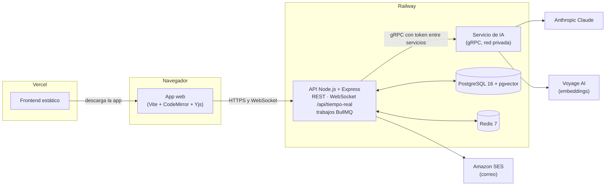
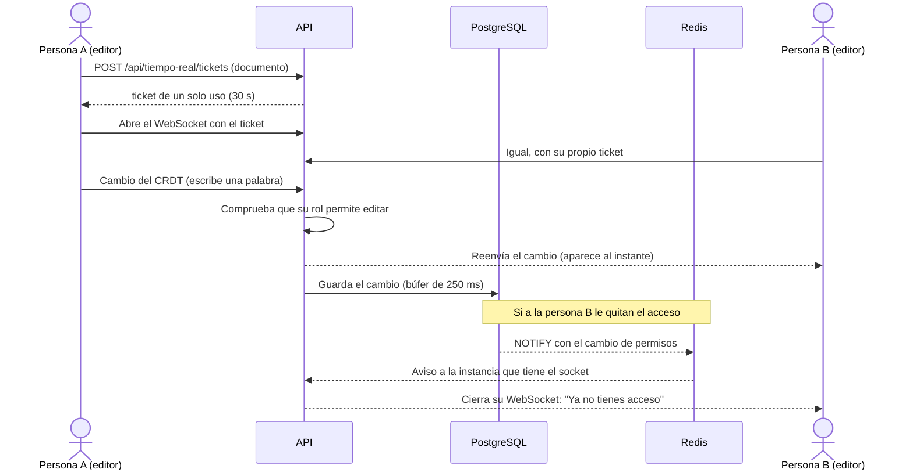

# Cuaderno: editor colaborativo de documentación técnica con IA

**Producción:** aplicación en <https://cuaderno.jonarproyectos.com> · API en
`api-cuaderno.jonarproyectos.com` (estado: [`/ready`](https://api-cuaderno.jonarproyectos.com/ready)).

Este README es la guía para evaluar el proyecto completo sin ayuda. El proyecto vive en tres
repositorios; este (`editor-ia-backend`) es el principal y tiene la guía de pruebas. Los otros dos
explican su parte y enlazan aquí:

| Repositorio          | Qué contiene                                                                                  |
| -------------------- | --------------------------------------------------------------------------------------------- |
| `editor-ia-backend`  | **Este.** API REST, WebSocket de edición en tiempo real y el servicio de IA (gRPC).           |
| `editor-ia-frontend` | La aplicación web: documentos, editor colaborativo, historial, asistente de IA, cuenta y administración. |
| `editor-ia-database` | El esquema de PostgreSQL (migraciones SQL), el usuario de base con privilegios mínimos y sus pruebas. |

## Contenido

1. [Qué es el proyecto](#1-qué-es-el-proyecto)
2. [Cómo funciona](#2-cómo-funciona)
3. [Tecnologías](#3-tecnologías)

## 1. Qué es el proyecto

**Cuaderno** es un editor de documentación técnica en Markdown donde varias personas escriben el
mismo documento a la vez, como en un procesador de textos en línea. Cada versión guardada queda
encadenada con un hash para poder comprobar que nadie la alteró, y un asistente de IA explica,
resume y mejora el texto, sugiere cómo seguir escribiendo y busca por significado dentro del
espacio de trabajo. Está pensado para equipos pequeños que documentan software juntos; las cuentas
se crean solo por invitación de la administración.

Capacidades principales:

- **Espacios y documentos** con roles: propietario, edición y lectura.
- **Edición colaborativa en tiempo real** con presencia (quién está, su cursor y su selección) y
  edición sin conexión que se sincroniza al volver.
- **Vista previa** de Markdown con fórmulas (KaTeX) y código resaltado, sin ejecutar HTML peligroso.
- **Comentarios** anclados a un tramo del texto, con respuestas y resolución.
- **Historial de versiones** con comparación, restauración y **verificación de la cadena de hash**.
- **Asistente de IA**: explicar, resumir, mejorar (como propuesta), autocompletar mientras escribes
  y búsqueda semántica en el espacio, con topes de uso diarios.
- **Cuentas** por invitación, verificación en dos pasos (obligatoria para administración),
  recuperación de contraseña, sesiones abiertas, foto, exportación y eliminación de la cuenta.

## 2. Cómo funciona

### El recorrido de principio a fin

1. **La administración invita** a una persona con su nombre, su correo y sus permisos. Le llega un
   enlace por correo para **crear su cuenta**; el enlace nunca se muestra en pantalla.
2. **La persona entra** (con verificación en dos pasos si es de administración). Su sesión usa un
   token de acceso que vive solo en memoria y una cookie de renovación que el JavaScript no puede
   leer.
3. **Crea un espacio y un documento.** El editor abre una conexión WebSocket con un ticket de un solo
   uso. Cada tecla viaja como un cambio pequeño de un CRDT (una estructura de datos que permite que
   varias personas editen a la vez y siempre lleguen al mismo texto, sin conflictos), el servidor lo
   reparte a los demás y lo guarda en PostgreSQL.
4. **Si alguien pierde acceso** (lo quitan del espacio, le bajan el rol), la base avisa al servidor y
   este corta o limita su conexión en milisegundos.
5. **Las versiones** se guardan a mano o por restauración; cada una lleva el hash de la anterior, y la
   base lo recalcula al verificar.
6. **La IA** no la llama el navegador: el API habla por **gRPC** con un servicio de IA aparte, que usa
   Anthropic Claude para el texto y Voyage para los embeddings de la búsqueda. Las respuestas largas
   llegan por partes (streaming) y se pueden detener.

### Arquitectura

El DNS está en Cloudflare. La aplicación (`cuaderno.`) y la API (`api-cuaderno.`) son orígenes
distintos del mismo sitio: la cookie de sesión viaja entre los dos, y el API responde con CORS solo
al origen de la aplicación.

### Flujo principal: dos personas editando el mismo documento

Más detalle: el protocolo del WebSocket en
[docs/protocolo-tiempo-real.md](docs/protocolo-tiempo-real.md), las decisiones en
[docs/adr/](docs/adr/), todas las rutas en [docs/referencia-tecnica.md](docs/referencia-tecnica.md)
y el contrato de la API en [docs/openapi.json](docs/openapi.json).

## 3. Tecnologías

Versiones exactas fijadas en el `package.json` de cada repositorio, el `Dockerfile` y el
`docker-compose.yml` de `editor-ia-database`.

| Tecnología                                  | Versión                                  | Para qué se usa                                                           | Por qué se eligió                                                                                                     |
| ------------------------------------------- | ---------------------------------------- | ------------------------------------------------------------------------- | --------------------------------------------------------------------------------------------------------------------- |
| **Node.js**                                 | 24 (mínimo declarado; imagen `node:24-bookworm-slim`) | API y servicio de IA                                         | Un solo lenguaje con el frontend; bueno para muchas conexiones abiertas.                                              |
| **TypeScript**                              | 6.0.3                                    | Lenguaje del backend                                                      | Tipos compartidos entre REST, gRPC y la base.                                                                         |
| **Express**                                 | 5.3.0                                    | API REST                                                                  | Estándar conocido; la versión 5 maneja errores de funciones `async` sin envoltorios.                                 |
| **zod** + **zod-to-openapi**                | 4.6.7 · 9.1.0                            | Validación de entradas y configuración; genera `docs/openapi.json`        | Un solo esquema para validar y documentar; la CI falla si la documentación queda desactualizada.                      |
| **ws**                                      | 8.22.0                                   | WebSocket de edición en tiempo real                                       | Control del ticket en el subprotocolo, del `Origin` y de cada mensaje.                                                |
| **Yjs** + **y-protocols**                   | 13.6.33 · 1.0.7                          | CRDT de los documentos, presencia y sincronización                        | Convergencia garantizada sin servidor de bloqueo y edición sin conexión ([ADR 0003](docs/adr/0003-crdt.md)).          |
| **gRPC** (`@grpc/grpc-js`, proto-loader) y **buf** | 1.14.6 · 0.8.1 · buf 1.73.0      | Comunicación API ↔ servicio de IA (unaria, streaming del servidor, del cliente y bidireccional) | Contrato tipado, streaming, deadlines y cancelación; buf detecta cambios incompatibles ([ADR 0002](docs/adr/0002-comunicacion.md)). |
| **Anthropic Claude** (`@anthropic-ai/sdk`)  | 1.3.0                                    | Explicar, resumir, mejorar y autocompletar                                | Detrás de un proveedor intercambiable; en desarrollo, `AI_PROVIDER=mock`.                                             |
| **Voyage AI**                               | modelo configurable (`VOYAGE_MODEL`)     | Embeddings de 1024 dimensiones para la búsqueda por significado           | El API verifica la dimensión al conectar con el servicio.                                                             |
| **PostgreSQL + pgvector**                   | imagen `pgvector/pgvector:pg16`          | Datos, permisos, cadena de versiones, vectores y avisos (`NOTIFY`)        | Las reglas viven en la base (triggers, RLS y un usuario con privilegios mínimos).                                     |
| **Prisma** (con `@prisma/adapter-pg`)       | 7.10.0                                   | Cliente tipado de la base                                                 | Solo como cliente; `prisma:check` falla si el esquema se desvía de la base.                                           |
| **Redis** (ioredis) + **BullMQ**            | imagen `redis:7-alpine` · 6.0.0 · 6.3.10 | Límites de uso, tickets, avisos entre instancias, cola de indexado y retención diaria | Estado compartido entre instancias; los límites fallan cerrados.                                         |
| **AWS SDK SES v2** (con **Amazon SES**)     | `@aws-sdk/client-sesv2` 3.1151.0         | Correos: invitaciones, recuperación, cambio de correo y avisos            | API oficial; en desarrollo, `EMAIL_PROVIDER=mock` con un buzón simulado.                                              |
| **helmet** · **pino** · **prom-client**     | 8.3.0 · 10.4.0 · 15.1.3                  | Cabeceras de seguridad, logs JSON sin secretos y métricas Prometheus      | Operación: `/health`, `/ready` y `/metrics`.                                                                          |
| **Vite** · **CodeMirror 6** · **KaTeX** · **highlight.js** (frontend) | 8.3.5 · 6.x · 0.19.0 · 11.12.0 | Build, editor, fórmulas y código resaltado                       | Editor accesible y extensible; KaTeX y highlight.js se cargan solo al usarse.                                         |
| **Vitest** · **Supertest** · **Playwright** · **axe** | 5.0.4 · 7.3.1 · 1.63.0 · 4.13.0 | Pruebas unitarias, de integración, E2E y accesibilidad                | Integración contra la base y Redis reales, en una base de pruebas aparte.                                             |
| **ESLint**                                  | 10.12.0                                  | Reglas del código en los tres repositorios                                | La CI lo exige.                                                                                                       |
| **GitHub Actions** · **gitleaks**           | —                                        | CI: lint, tipos, chequeos de Prisma, OpenAPI y proto, tests, build, mutaciones, `npm audit` y secretos | Nada llega a `main` sin pasar todo.                                        |
| **Docker**                                  | —                                        | Una imagen para el API y el servicio de IA; PostgreSQL y Redis en desarrollo | El mismo artefacto en local y en Railway, sin usuario root.                                                        |
| **Railway** · **Vercel** · **Cloudflare**   | —                                        | API, servicio de IA, PostgreSQL y Redis en Railway; frontend en Vercel; DNS en Cloudflare | HTTPS automático, dominios propios y red privada entre el API y la IA.                                     |
