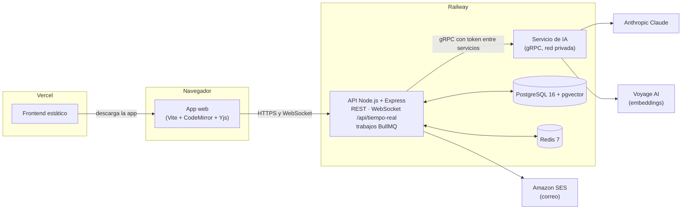
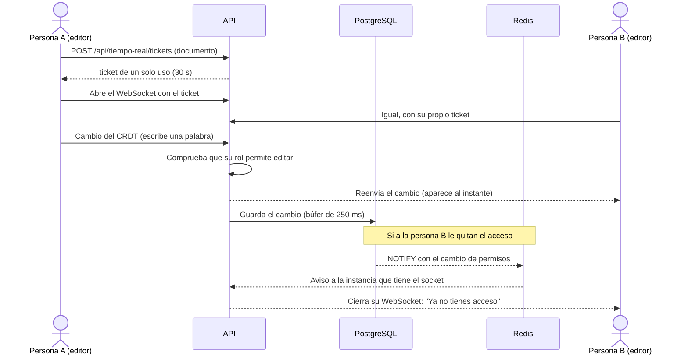

# Cuaderno: editor colaborativo de documentación técnica con IA

**Producción:** aplicación en <https://cuaderno.jonarproyectos.com> · API en
`api-cuaderno.jonarproyectos.com` (estado: [`/ready`](https://api-cuaderno.jonarproyectos.com/ready)).

Este README es la guía para evaluar el proyecto completo sin ayuda. El proyecto vive en tres
repositorios; este (`editor-ia-backend`) es el principal y tiene la guía de pruebas. Los otros dos
explican su parte y enlazan aquí:

| Repositorio          | Qué contiene                                                                                  |
| -------------------- | --------------------------------------------------------------------------------------------- |
| `editor-ia-backend`  | **Este.** API REST, WebSocket de edición en tiempo real y el servicio de IA (gRPC).           |
| `editor-ia-frontend` | La aplicación web: documentos, editor colaborativo, historial, asistente de IA, cuenta y administración. |
| `editor-ia-database` | El esquema de PostgreSQL (migraciones SQL), el usuario de base con privilegios mínimos y sus pruebas. |

## Contenido

1. [Qué es el proyecto](#1-qué-es-el-proyecto)
2. [Cómo funciona](#2-cómo-funciona)
3. [Tecnologías](#3-tecnologías)
4. [Qué necesita el profesor](#4-qué-necesita-el-profesor)
5. [Acceso y roles](#5-acceso-y-roles)

## 1. Qué es el proyecto

**Cuaderno** es un editor de documentación técnica en Markdown donde varias personas escriben el
mismo documento a la vez, como en un procesador de textos en línea. Cada versión guardada queda
encadenada con un hash para poder comprobar que nadie la alteró, y un asistente de IA explica,
resume y mejora el texto, sugiere cómo seguir escribiendo y busca por significado dentro del
espacio de trabajo. Está pensado para equipos pequeños que documentan software juntos; las cuentas
se crean solo por invitación de la administración.

Capacidades principales:

- **Espacios y documentos** con roles: propietario, edición y lectura.
- **Edición colaborativa en tiempo real** con presencia (quién está, su cursor y su selección) y
  edición sin conexión que se sincroniza al volver.
- **Vista previa** de Markdown con fórmulas (KaTeX) y código resaltado, sin ejecutar HTML peligroso.
- **Comentarios** anclados a un tramo del texto, con respuestas y resolución.
- **Historial de versiones** con comparación, restauración y **verificación de la cadena de hash**.
- **Asistente de IA**: explicar, resumir, mejorar (como propuesta), autocompletar mientras escribes
  y búsqueda semántica en el espacio, con topes de uso diarios.
- **Cuentas** por invitación, verificación en dos pasos (obligatoria para administración),
  recuperación de contraseña, sesiones abiertas, foto, exportación y eliminación de la cuenta.

## 2. Cómo funciona

### El recorrido de principio a fin

1. **La administración invita** a una persona con su nombre, su correo y sus permisos. Le llega un
   enlace por correo para **crear su cuenta**; el enlace nunca se muestra en pantalla.
2. **La persona entra** (con verificación en dos pasos si es de administración). Su sesión usa un
   token de acceso que vive solo en memoria y una cookie de renovación que el JavaScript no puede
   leer.
3. **Crea un espacio y un documento.** El editor abre una conexión WebSocket con un ticket de un solo
   uso. Cada tecla viaja como un cambio pequeño de un CRDT (una estructura de datos que permite que
   varias personas editen a la vez y siempre lleguen al mismo texto, sin conflictos), el servidor lo
   reparte a los demás y lo guarda en PostgreSQL.
4. **Si alguien pierde acceso** (lo quitan del espacio, le bajan el rol), la base avisa al servidor y
   este corta o limita su conexión en milisegundos.
5. **Las versiones** se guardan a mano o por restauración; cada una lleva el hash de la anterior, y la
   base lo recalcula al verificar.
6. **La IA** no la llama el navegador: el API habla por **gRPC** con un servicio de IA aparte, que usa
   Anthropic Claude para el texto y Voyage para los embeddings de la búsqueda. Las respuestas largas
   llegan por partes (streaming) y se pueden detener.

### Arquitectura



El DNS está en Cloudflare. La aplicación (`cuaderno.`) y la API (`api-cuaderno.`) son orígenes
distintos del mismo sitio: la cookie de sesión viaja entre los dos, y el API responde con CORS solo
al origen de la aplicación.

### Flujo principal: dos personas editando el mismo documento



Más detalle: el protocolo del WebSocket en
[docs/protocolo-tiempo-real.md](docs/protocolo-tiempo-real.md), las decisiones en
[docs/adr/](docs/adr/), todas las rutas en [docs/referencia-tecnica.md](docs/referencia-tecnica.md)
y el contrato de la API en [docs/openapi.json](docs/openapi.json).

## 3. Tecnologías

Versiones exactas fijadas en el `package.json` de cada repositorio, el `Dockerfile` y el
`docker-compose.yml` de `editor-ia-database`.

| Tecnología                                  | Versión                                  | Para qué se usa                                                           | Por qué se eligió                                                                                                     |
| ------------------------------------------- | ---------------------------------------- | ------------------------------------------------------------------------- | --------------------------------------------------------------------------------------------------------------------- |
| **Node.js**                                 | 24 (mínimo declarado; imagen `node:24-bookworm-slim`) | API y servicio de IA                                         | Un solo lenguaje con el frontend; bueno para muchas conexiones abiertas.                                              |
| **TypeScript**                              | 6.0.3                                    | Lenguaje del backend                                                      | Tipos compartidos entre REST, gRPC y la base.                                                                         |
| **Express**                                 | 5.3.0                                    | API REST                                                                  | Estándar conocido; la versión 5 maneja errores de funciones `async` sin envoltorios.                                 |
| **zod** + **zod-to-openapi**                | 4.6.7 · 9.1.0                            | Validación de entradas y configuración; genera `docs/openapi.json`        | Un solo esquema para validar y documentar; la CI falla si la documentación queda desactualizada.                      |
| **ws**                                      | 8.22.0                                   | WebSocket de edición en tiempo real                                       | Control del ticket en el subprotocolo, del `Origin` y de cada mensaje.                                                |
| **Yjs** + **y-protocols**                   | 13.6.33 · 1.0.7                          | CRDT de los documentos, presencia y sincronización                        | Convergencia garantizada sin servidor de bloqueo y edición sin conexión ([ADR 0003](docs/adr/0003-crdt.md)).          |
| **gRPC** (`@grpc/grpc-js`, proto-loader) y **buf** | 1.14.6 · 0.8.1 · buf 1.73.0      | Comunicación API ↔ servicio de IA (unaria, streaming del servidor, del cliente y bidireccional) | Contrato tipado, streaming, deadlines y cancelación; buf detecta cambios incompatibles ([ADR 0002](docs/adr/0002-comunicacion.md)). |
| **Anthropic Claude** (`@anthropic-ai/sdk`)  | 1.3.0                                    | Explicar, resumir, mejorar y autocompletar                                | Detrás de un proveedor intercambiable; en desarrollo, `AI_PROVIDER=mock`.                                             |
| **Voyage AI**                               | modelo configurable (`VOYAGE_MODEL`)     | Embeddings de 1024 dimensiones para la búsqueda por significado           | El API verifica la dimensión al conectar con el servicio.                                                             |
| **PostgreSQL + pgvector**                   | imagen `pgvector/pgvector:pg16`          | Datos, permisos, cadena de versiones, vectores y avisos (`NOTIFY`)        | Las reglas viven en la base (restricciones, triggers y un usuario con privilegios mínimos).                                     |
| **Prisma** (con `@prisma/adapter-pg`)       | 7.10.0                                   | Cliente tipado de la base                                                 | Solo como cliente; `prisma:check` falla si el esquema se desvía de la base.                                           |
| **Redis** (ioredis) + **BullMQ**            | imagen `redis:7-alpine` · 6.0.0 · 6.3.10 | Límites de uso, tickets, avisos entre instancias, cola de indexado y retención diaria | Estado compartido entre instancias; los límites fallan cerrados.                                         |
| **AWS SDK SES v2** (con **Amazon SES**)     | `@aws-sdk/client-sesv2` 3.1151.0         | Correos: invitaciones, recuperación, cambio de correo y avisos            | API oficial; en desarrollo, `EMAIL_PROVIDER=mock` con un buzón simulado.                                              |
| **helmet** · **pino** · **prom-client**     | 8.3.0 · 10.4.0 · 15.1.3                  | Cabeceras de seguridad, logs JSON sin secretos y métricas Prometheus      | Operación: `/health`, `/ready` y `/metrics`.                                                                          |
| **Vite** · **CodeMirror 6** · **KaTeX** · **highlight.js** (frontend) | 8.3.5 · 6.x · 0.19.0 · 11.12.0 | Build, editor, fórmulas y código resaltado                       | Editor accesible y extensible; KaTeX y highlight.js se cargan solo al usarse.                                         |
| **Vitest** · **Supertest** · **Playwright** · **axe** | 5.0.4 · 7.3.1 · 1.63.0 · 4.13.0 | Pruebas unitarias, de integración, E2E y accesibilidad                | Integración contra la base y Redis reales, en una base de pruebas aparte.                                             |
| **ESLint**                                  | 10.12.0                                  | Reglas del código en los tres repositorios                                | La CI lo exige.                                                                                                       |
| **GitHub Actions** · **gitleaks**           | —                                        | CI: lint, tipos, chequeos de Prisma, OpenAPI y proto, tests, build, mutaciones, `npm audit` y secretos | Nada llega a `main` sin pasar todo.                                        |
| **Docker**                                  | —                                        | Una imagen para el API y el servicio de IA; PostgreSQL y Redis en desarrollo | El mismo artefacto en local y en Railway, sin usuario root.                                                        |
| **Railway** · **Vercel** · **Cloudflare**   | —                                        | API, servicio de IA, PostgreSQL y Redis en Railway; frontend en Vercel; DNS en Cloudflare | HTTPS automático, dominios propios y red privada entre el API y la IA.                                     |

## 4. Qué necesita el profesor

### a) Opción recomendada: solo el navegador

- Un navegador actualizado: **Chrome, Edge o Firefox** de escritorio, con acceso a internet.
- La URL: <https://cuaderno.jonarproyectos.com>. No hay que instalar nada, ni micrófono ni
  altavoces (Cuaderno no tiene funciones de voz).
- **Para la cuenta de administración:** una aplicación de códigos en el teléfono (Google
  Authenticator, Microsoft Authenticator o similar): la verificación en dos pasos es obligatoria
  para ese permiso.
- **Para probar la edición en tiempo real:** dos ventanas lado a lado. Con **una sola cuenta** basta
  abrir el mismo documento en dos pestañas: lo que se escribe en una aparece en la otra. Para ver a
  **dos personas** (presencia con nombres, permisos distintos, revocación en vivo) hacen falta dos
  cuentas que compartan un espacio, una en una ventana normal y otra en una de incógnito (ver
  [Acceso y roles](#5-acceso-y-roles)).
- Para la foto de perfil: una imagen JPEG o PNG.

Comprobación rápida de que todo está en línea: abre
<https://api-cuaderno.jonarproyectos.com/ready>. Debe mostrar
`{"estado":"listo","comprobaciones":{"bd":"ok","esquema":"ok","redis":"ok","ia":"ok"}}`.

### b) Opción local (opcional)

Levanta todo en tu equipo con la IA y el correo **simulados** (no hace falta ninguna clave externa).
Los comandos son para `cmd.exe` en Windows 10 u 11 y se probaron así. La guía paso a paso con todo
el detalle (qué debe aparecer en cada ventana) está en
[docs/guia-demostracion.md](docs/guia-demostracion.md).

**Requisitos:** [Node.js](https://nodejs.org/) **24 o superior**,
[Docker Desktop](https://www.docker.com/products/docker-desktop/) encendido (PostgreSQL, Redis y las
réplicas de Linux corren en contenedores; no hace falta `psql`), [Git](https://git-scm.com/) y los
puertos libres 5435 (PostgreSQL), 6381 (Redis), 4200 (API), 4210 (servicio de IA) y 5175
(frontend).

**1. Clona los tres repositorios en la misma carpeta** (el backend busca el esquema en
`..\editor-ia-database`):

```bat
set RAIZ=C:\cuaderno-demo
mkdir "%RAIZ%"
cd /d "%RAIZ%"
git clone https://github.com/Jonar519/editor-ia-database.git
git clone https://github.com/Jonar519/editor-ia-backend.git
git clone https://github.com/Jonar519/editor-ia-frontend.git
```

**2. Base de datos y Redis:**

```bat
cd /d "%RAIZ%\editor-ia-database"
npm ci
scripts\db-up.bat
scripts\db-migrate.bat dev
```

Esperado: `db-up` crea `.env` con contraseñas locales aleatorias y levanta `cuaderno_postgres` y
`cuaderno_redis`; la migración termina con `Base cuaderno: 23 migraciones aplicadas.`
(`scripts\db-migrate.bat dev --estado` → `23 aplicadas, 0 pendientes`).

**3. API** (deja esta ventana abierta):

```bat
cd /d "%RAIZ%\editor-ia-backend"
npm ci
npm run prisma:generate
npm run proto:generate
scripts\env-init.bat
scripts\bd-preparar.bat
scripts\dev.bat
```

`env-init.bat` crea o completa `.env` con secretos aleatorios propios (nunca cambia un valor que ya
exista); los valores de desarrollo quedan así, por ejemplo:

```ini
APP_URL=http://127.0.0.1:5175
TRUST_PROXY=0
AI_PROVIDER=mock
EMAIL_PROVIDER=mock
GEO_PROVIDER=mock
```

Esperado: el log `Cuaderno API escuchando` en el puerto 4200.

**4. Servicio de IA** (otra ventana; repite `set RAIZ=C:\cuaderno-demo`):

```bat
cd /d "%RAIZ%\editor-ia-backend"
scripts\ia.bat
```

Esperado: `Cuaderno IA escuchando (gRPC)` con `"puerto":4210` y `"proveedor":"mock"`.

**5. Frontend** (otra ventana):

```bat
cd /d "%RAIZ%\editor-ia-frontend"
npm ci
scripts\dev.bat
```

Esperado: `Local: http://127.0.0.1:5175/`. Usa siempre `127.0.0.1`, no `localhost`: el API compara
el origen con `APP_URL`.

**6. Comprueba que funciona y crea la primera cuenta** (en una cuarta ventana):

```bat
cd /d "%RAIZ%\editor-ia-backend"
curl -s http://127.0.0.1:4200/ready
scripts\invitar.bat --correo marta.demo@example.com --nombre "Marta Ficticia" --rol admin
scripts\buzon.bat marta.demo@example.com
```

Esperado: `/ready` con todo en `ok`; `invitar` dice que el enlace se envió al correo (no lo muestra);
`buzon` (el correo simulado) muestra el enlace `http://127.0.0.1:5175/#/invitacion/…`. Ábrelo, elige
una contraseña de 12 caracteres o más y escribe el código de tu app autenticadora (sin app:
`scripts\totp.bat <secreto sin espacios>`). Después sigue la
[guía de pruebas](#6-guía-de-pruebas-función-por-función); en local, los correos se leen con
`scripts\buzon.bat <correo>` y la IA simulada responde con textos fijos.

Para detener todo: **Ctrl+C** en cada ventana y `scripts\db-down.bat` en `editor-ia-database`.

## 5. Acceso y roles

### Roles

Hay dos niveles. El **permiso de la cuenta** (lo elige la administración al invitar) pone el techo; el
**rol en cada espacio** decide qué puede hacer ahí, sin superar ese techo.

| Permiso de la cuenta | Qué puede hacer                                                                                                                                            |
| -------------------- | ---------------------------------------------------------------------------------------------------------------------------------------------------------- |
| **Lectura**          | Ver los documentos de los espacios donde es miembro, comentar, ver el historial y usar Explicar y Resumir de la IA. No crea espacios ni edita.             |
| **Edición**          | Además, crear espacios y documentos, editar, guardar y restaurar versiones, Mejorar con la IA, las sugerencias al escribir y el índice de búsqueda.       |
| **Administración**   | Además, invitar personas y administrar las invitaciones (**Administración**). Verificación en dos pasos obligatoria.                                       |

| Rol en un espacio  | Qué significa                                                                                                                         |
| ------------------ | ------------------------------------------------------------------------------------------------------------------------------------- |
| **Propietario**    | Quien lo creó: agrega y quita miembros, cambia sus roles, transfiere el espacio y lo borra (solo si es el único miembro).                                               |
| **Edición**        | Crea y edita documentos del espacio. Quien crea un documento es su propietario (ser dueño del espacio no da la propiedad del documento). |
| **Lectura**        | Solo lee (y comenta). Una cuenta de Lectura nunca puede tener un rol mayor: la base lo impide.                                        |

Agregar miembros a un espacio, transferir la propiedad y dar permisos por documento se hace **por la
API** (no tienen pantalla); ver la [referencia técnica](docs/referencia-tecnica.md#api). Sin acceso a
un documento la API responde 404 (no revela que existe); con acceso pero sin el rol, 403.

### Credenciales

Las credenciales **no** están en este README. El estudiante las entrega por un canal privado, o envía
una **invitación por correo** a la dirección del profesor, idealmente dos (una de Administración y
otra de Lectura o Edición) y un espacio compartido entre ellas para probar la colaboración y los
permisos:

<!-- ACCESO: lo completa el estudiante -->

- **Invitación por correo:** trae un enlace a **Crear tu cuenta** ("Hola, …. Te invitaron con permisos
  de …"). Eliges tu contraseña (12 caracteres o más; una frase sirve). Si la invitación es de
  Administración, en la misma pantalla aparece el secreto para tu app de códigos y pide el código de
  6 dígitos; al crear la cuenta se muestran **10 códigos de respaldo** una sola vez.
- **Vence a las 72 horas** y sirve una sola vez. En la pantalla de administración, una vencida dice
  **Venció: hay que reenviarla**: pide al estudiante que pulse **Reenviar** (llega un enlace nuevo y el
  anterior deja de servir).
- **Si no llega el correo:** revisa spam. El servicio de correo está en modo de pruebas y solo
  entrega a direcciones verificadas por el estudiante (ver
  [Limitaciones](#8-limitaciones-conocidas-y-decisiones-de-diseño)).

### Verificación en dos pasos

- **Administración: obligatoria** y no se puede desactivar.
- **Edición y Lectura: opcional**, en **Tu cuenta → Verificación en dos pasos**.
- Al entrar, después de la contraseña se pide el código de la app; con **Usar un código de respaldo**
  se usa uno de los 10 códigos, que sirve una sola vez.

### Si algo del acceso falla

| Situación                                      | Qué hacer                                                                                                                                                      |
| ---------------------------------------------- | -------------------------------------------------------------------------------------------------------------------------------------------------------------- |
| Olvidaste la contraseña                        | En **Entrar**, **¿Olvidaste tu contraseña?** → tu correo → **Enviar el enlace**. El mensaje es el mismo exista o no la cuenta; el enlace vence en 15 minutos y al usarlo se cierran todas tus sesiones. |
| El código no es válido                         | Revisa que la hora del teléfono sea automática, o usa un código de respaldo.                                                                                   |
| Perdiste el teléfono y los códigos de respaldo | La app no permite recuperar la verificación en dos pasos (a propósito). Avisa al estudiante.                                                                   |
| La sesión se cerró sola                        | El acceso dura 15 minutos y se renueva solo mientras usas la app. Si se cerraron tus sesiones desde **Sesiones abiertas** o cambiaste la contraseña, vuelve a entrar. |
| "Demasiadas solicitudes"                        | Hay límites por ruta sensible (inicio de sesión, verificación, recuperación…). Espera un minuto y vuelve a intentar.                                           |
