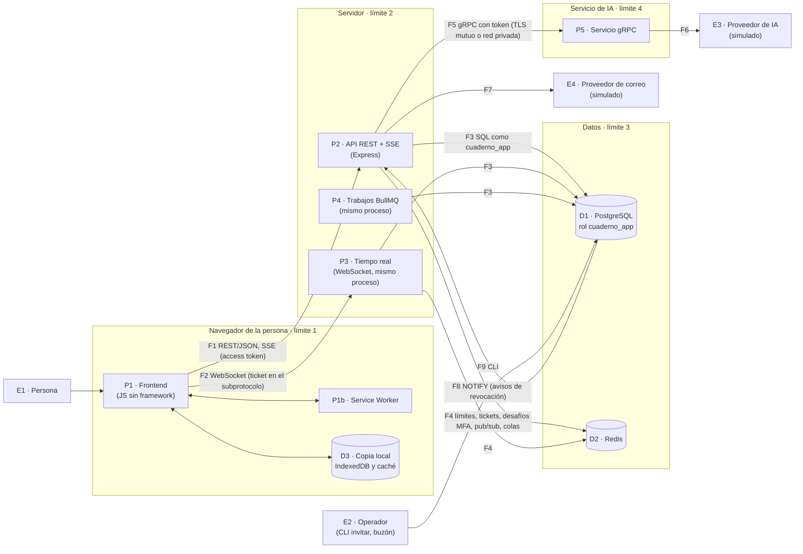

# Modelo de amenazas

Análisis STRIDE de Cuaderno (bloque R4) y sus **riesgos residuales**: lo que el diseño acepta a sabiendas, con su límite medido y lo que lo acota. Los riesgos residuales se escriben desde el tramo 3, a medida que se deciden.

## Alcance y supuestos

- **Lo que se analiza:** el sistema como está en el repo al cierre del bloque R: frontend, API con tiempo real y trabajos, PostgreSQL, Redis y el servicio de IA.
- **Lo que NO se analiza** (no existe todavía):
  - el despliegue: red, TLS, proxy inverso, secretos en la nube, copias de seguridad;
  - un proveedor real de IA o de correo: los dos son simulados.

  Donde una amenaza depende de eso, se dice, y su riesgo queda abierto.
- **Atacantes considerados:**
  1. alguien de Internet sin cuenta;
  2. una persona con cuenta (lector, editor o admin) que abusa de lo que puede hacer;
  3. alguien que perdió el acceso hace poco (le quitaron el rol o la sesión);
  4. el contenido de un documento escrito por otra persona: texto que intenta inyectar HTML o instrucciones para la IA;
  5. un tercero en la red entre servicios.
- **Fuera del modelo:** quien controla el sistema operativo del servidor, el dueño de la base o el equipo de la persona. La cadena de hash de las versiones **detecta** una manipulación del dueño de la base (prueba de R1), pero no la impide.
- **Cómo se lee la evidencia:**
  - **back**, **front** y **base** son los catálogos de mutaciones de editor-ia-backend, editor-ia-frontend y editor-ia-database (`mutations/catalogo.json`; `scripts\mutar.bat <id>` en cada repo). Cada mutación quita la defensa y alguna prueba falla.
  - Un archivo de prueba sin mutación se nombra por su ruta.
  - **Sin prueba propia** quiere decir que el código existe pero ninguna prueba automática falla si se quita.

## Diagrama de flujo de datos

| Límite de confianza | Qué separa | Qué lo cruza |
|---|---|---|
| 1 · Navegador | El equipo de la persona (que no controlamos) y el contenido escrito por otras personas | F1, F2. El documento compartido entra a la página como dato, nunca como código. |
| 2 · Servidor | Internet y el proceso del API | F1, F2: todo se valida (zod), se autentica (sesión viva) y se autoriza (rol efectivo) del lado del servidor. |
| 3 · Datos | El API y la base y Redis | F3, F4, F8. La base repite las reglas de integridad y de permisos con restricciones y triggers: un error del API no las salta. |
| 4 · Servicio de IA | El API y el servicio que habla con el proveedor | F5: token de servicio y TLS mutuo o red privada declarada (R-03). El servicio no tiene acceso a la base. |

## Análisis por elemento (STRIDE)

S: suplantación; T: manipulación; R: repudio; I: revelación de información; D: denegación de servicio; E: elevación de privilegios. Cada fila dice la amenaza, cómo se mitiga, la evidencia y el riesgo que queda.

### E1 y F1 · La persona y el tráfico REST

| | Amenaza | Mitigación | Evidencia | Queda |
|---|---|---|---|---|
| S | Robar o adivinar una sesión; reutilizar un refresh robado | Access token HMAC de 15 min, solo en memoria; refresh rotativo con detección de reutilización (revoca la familia); cookie `httpOnly`, `SameSite=Strict`, `Path=/api/auth` | back E01–E11; front H26–H31 | Un XSS podría leer el access token en memoria (15 min). Lo acota la CSP (R-06). |
| S | Fuerza bruta de contraseñas o códigos MFA | Bloqueo progresivo por cuenta, también para correos inexistentes; 20 inicios por IP cada 15 min; los fallos de MFA suman al bloqueo; los límites fallan cerrado si Redis no responde | back E14–E19, G12; R3 (H4: el límite responde 429 a 5 600–7 000 pedidos/s) | Con muchas IP (botnet), el límite por IP no basta; lo frena el bloqueo por cuenta. |
| S | Entrar sin el segundo factor | Una cuenta con MFA no entra solo con la contraseña; TOTP sin librería con vectores del RFC; anti-replay en el API y en la base | back E20, G03–G06, G13; base F15, B34 | — |
| S | CSRF sobre las rutas con cookie | `SameSite=Strict` y, además, el `Origin` tiene que ser el del frontend | back E11, E13 | — |
| T | Cuerpos malformados o enormes | zod en cada entrada; JSON de 100 kB como máximo; cuerpos comprimidos rechazados con 415 (GHSA-27r3-jxmh-p828) | back S11, S15, B01–B03 | — |
| R | Negar haber hecho un cambio de seguridad o de permisos | `eventos_seguridad` de solo inserción, sin texto libre, con IP truncada; cada concesión y revocación de permisos queda registrada (0022) | back G23; base F08–F13 | Los cambios de contenido tienen autor (actualizaciones y versiones), pero no hay un registro firmado por el cliente. |
| I | Enumerar cuentas por login, recuperación, invitación o miembros | Mismo tiempo y misma respuesta exista o no el correo (hash señuelo); la recuperación responde antes de trabajar; agregar miembros: 404 genérico y 30 cada 15 min | back E15, E16, G18, W09, W16 | — |
| I | Que el log o la exportación filtren secretos | Redacción de cabeceras y campos; nunca el cuerpo; exportación con lista blanca de columnas | back S12, S13, G01, G02, U26; `tests/integracion/secretos.test.ts` | — |
| I | Ver contenido ajeno adivinando ids | Sin acceso, 404 igual que «no existe»; el rol efectivo lo calcula la base | back W05, W06; base C26–C29 | — |
| D | Agotar el único proceso del API con pedidos válidos | Límite general de 600 pedidos por minuto y cuenta en todo `/api` (429 con `Retry-After`; 503 si Redis falla); límites por ruta sensible (login, recuperación, MFA, cuenta, invitaciones, versiones, comentarios, IA, tickets); `statement_timeout` | back R08–R10, S26, E17, R03; `tests/integracion/limite-general.test.ts`; costo medido ([limite-r](limite-r/carga-r.md)) | **R-07**: muchas cuentas a la vez, o pedidos sin token, no los frena este límite. |
| E | Hacer más de lo que el rol permite | Una sola función de acceso (`src/contenido/acceso.ts`) y la base como segunda capa (rol efectivo, techo del rol de cuenta, triggers de escritura) | back W01–W21; base C09–C11, C26–C34 | — |
| E | Un admin creado sin MFA, o cuentas creadas sin invitación | Alta solo por invitación (la base lo exige); un admin activo siempre tiene MFA confirmado | back E24, E30; base B13, B20, B38 | — |

### P1 · Frontend, Service Worker y copia local (límite 1)

| | Amenaza | Mitigación | Evidencia | Queda |
|---|---|---|---|---|
| T | XSS desde el Markdown o el título de un documento ajeno | Sin `innerHTML` para contenido: nodos con `h()` (que rechaza atributos `on*`); el Markdown no admite HTML; saneador de segunda capa con listas blancas; enlaces solo `http`, `https`, `mailto` o ancla | front H21, O01–O04, Q02 | — |
| T | Que un script inyectado corra igual | CSP con `script-src 'self'`, sin `'unsafe-inline'` ni `'unsafe-eval'` | front R03–R05; E2E `csp.spec.mjs` | **R-06**: `'unsafe-inline'` en los estilos. |
| T | Redirigir después de entrar a otro sitio | El destino solo admite caminos internos | front H45, H46 | — |
| I | Que el Service Worker guarde respuestas del API | `/api` nunca pasa por la caché; solo mismo origen y solo GET | front H35–H39 | — |
| I | El token de un enlace (invitación, recuperación) en el historial | Se borra de la URL en cuanto se lee | front H42 | — |
| I | La copia local sin conexión en un equipo compartido | La copia vive en IndexedDB del navegador de la persona | front M01–M04 | Queda en el equipo hasta que se borren los datos del sitio. El modelo no cubre un equipo comprometido. |
| S | Presencia falsa: dibujar el cursor con el nombre de otra persona | El nombre y la cuenta de la presencia los pone el servidor | back T07, T09; front L01–L03 | — |
| E | Ver pantallas de otro rol | El router abre solo los grupos de cada rol (y el servidor autoriza igual) | front H18, H19 | Es comodidad: la autorización real está en el API. |

### P2 · API REST y SSE (límite 2)

| | Amenaza | Mitigación | Evidencia | Queda |
|---|---|---|---|---|
| S | Usar un access token de una sesión revocada | Cada pedido verifica la sesión viva en la base | back E05, E06 | — |
| T | Configuración insegura en producción | Validación al arrancar: sin proveedores simulados, `METRICS_TOKEN`, Redis con contraseña o TLS, `APP_URL` https, cookie `Secure`, scrypt 15+, usuario de base sin privilegios de más | back S01–S04, S22–S24, E31–E33, P24–P26 | Solo se valida al arrancar: no detecta un cambio posterior en la infraestructura. |
| I | Un error interno que filtre su mensaje | Respuesta genérica; detalle solo en el log | back S10 | — |
| I | `/metrics` abierto | Exige el token, comparado completo; etiquetas por patrón de ruta, no por URL | back S08, S09, S18 | — |
| I | Respuestas guardadas en cachés intermedias | `Cache-Control: no-store` | back E36 | — |
| I | Metadatos (GPS) en las fotos de perfil | Lista blanca de segmentos JPEG y chunks PNG; se guarda solo la versión limpia; se sirve con CSP `default-src 'none'; sandbox` | back U01–U11; base G03–G08 | — |
| D | Saturar el proceso con lecturas | Límite general por cuenta (600 por minuto): una cuenta sola ya no ocupa el proceso con pedidos válidos | back R08–R10. R3: con 10 conexiones, `GET /api/espacios` ya usaba un núcleo entero (2 580 pedidos/s en Linux). R4: con el límite, a esa cuenta se le responde 429 a 5 761–6 337 pedidos/s | **R-07** |
| D | Una consulta larga que bloquee la base | `statement_timeout` de 5 s | back S26 | — |
| D | Saturar la IA o su presupuesto | 30 pedidos por minuto, topes diarios de tokens y de pedidos, presupuesto del espacio para el indexado, salida recortada | back P15, P16, P36–P43 | Depende del proveedor real (R-04 y despliegue). |
| E | Que el API corra con privilegios de dueño o superusuario | Se detecta al arrancar y producción aborta | back S22–S24 | — |

### P3 · Tiempo real y F2 (WebSocket)

| | Amenaza | Mitigación | Evidencia | Queda |
|---|---|---|---|---|
| S | Secuestro del WebSocket entre sitios, o reutilizar un ticket | `Origin` exacto; ticket de un solo uso (`GETDEL`), de 30 s, en el subprotocolo y no en la URL | back T02, T03 | — |
| T | Que un lector escriba | Guardia en cada mensaje: la actualización de quien no puede escribir se descarta; a la tercera en 60 s, cierre 4403; la base rechaza al persistir | back T01, T08; base C10, C11 | — |
| I y E | Seguir recibiendo o escribiendo después de perder el acceso | Aviso de la base al COMMIT, reenviado por Redis (corte medido en 8–19 ms); revalidación al rechazar la base y cada 30 s | back T04–T06; base C36, K13–K15 | **R-01**: hasta 30 s de lectura y 250 ms de escritura si se pierde el aviso. |
| D | Inundar de mensajes o mandar mensajes enormes | 60 mensajes por segundo por conexión (4429); 1 MiB por mensaje (1009); 10 MiB por documento (4413); cola de envío de 4 MiB por cliente lento (1013); 60 tickets por minuto por cuenta | El cierre 4429 tiene prueba (`tests/integracion/tiempo-real.test.ts`). El mensaje de más de 1 MiB (1009), el tope de documento y la cola están **sin prueba propia** | Un solo proceso: R3 midió que 100 clientes a 5 cambios por segundo en un documento no llegan al ritmo pedido (175 de 500 cambios por segundo en Linux), con latencia p99 de 994 ms y sin pérdidas. |
| R | Negar haber escrito algo | Cada fila de `actualizaciones_documento` tiene autor (`autor_id`, obligatorio); las versiones manuales y las restauraciones también | base C13 | Se pierde por autor al compactar: el estado compactado no dice quién escribió cada parte. |

### P4 · Trabajos (retención, compactación, indexado, versiones automáticas)

| | Amenaza | Mitigación | Evidencia | Queda |
|---|---|---|---|---|
| T | Que la compactación borre de más o pise una más nueva | La hace la base en una función `SECURITY DEFINER` con `search_path` fijo; solo hasta `hasta_id`, solo de ese documento, con bloqueo | base K01–K12 | El dueño de la base no puede ser superusuario en producción (README general). |
| I | Indexar para la IA contenido de un documento sin acceso | El trabajo reverifica el acceso y la base lo exige con un trigger y una clave foránea compuesta | back P21, P35; base C19–C23 | — |
| D | Datos personales guardados de más | Retención diaria en la base (sesiones, tokens, correos simulados, eventos, uso de IA, cuentas pendientes vencidas) | back U32–U34; base G16–G23, P05–P07 | Las versiones no tienen retención (**R-02**). |

### D1 · PostgreSQL (límite 3)

| | Amenaza | Mitigación | Evidencia | Queda |
|---|---|---|---|---|
| T | Reescribir el historial de versiones | Solo inserción (sin UPDATE, DELETE ni TRUNCATE) y cadena de hash, verificable desde la interfaz | base C01–C08, D01; back R01–R03; front R01–R02 | El dueño de la base puede reescribir: la cadena lo **detecta**, no lo impide. |
| T | Estados imposibles de cuentas, sesiones o tokens | CHECK y claves foráneas compuestas atan cada fila al estado de su cuenta | base B01–B41, F01–F07 | — |
| E | Que la app haga lo que no necesita | Rol `cuaderno_app` con privilegios mínimos por tabla y por columna | base D01–D04, F12, K01 | — |
| I | Contraseñas, tokens o secretos legibles | scrypt; tokens como SHA-256; secreto MFA cifrado con AES-GCM ligado a la cuenta; códigos de respaldo con HMAC | base B18, B26, B35, B36; back G07, G08 | — |
| D | Llenar la base | Topes por fila (documento de 10 MiB, avatar de 1 MiB, mensaje de 1 MiB) | base G06 | **R-02**: versiones sin tope. |

### D2 · Redis

| | Amenaza | Mitigación | Evidencia | Queda |
|---|---|---|---|---|
| I | Leer desafíos MFA o tickets desde Redis | Solo su hash; vencen (5 min y 30 s); un solo uso | back G09–G11, T02 | — |
| D | Redis caído | Los límites fallan cerrado; no se aceptan conexiones de tiempo real nuevas; las abiertas se revalidan en la base | back E18, S27, S28 | Con Redis caído no se puede iniciar sesión: se prefiere cerrado a abierto. |
| S | Un tercero en la red habla con Redis | Producción exige contraseña o TLS | back S03 | En desarrollo no tiene contraseña: solo escucha en `127.0.0.1` (decisión vigente). |

### P5 · Servicio de IA y F5–F6 (límite 4)

| | Amenaza | Mitigación | Evidencia | Queda |
|---|---|---|---|---|
| S | Llamar al servicio sin ser el API | Token de servicio comparado en tiempo constante; solo la salud estándar responde sin él | back P01–P03 | — |
| I | Leer el tráfico entre el API y el servicio | Producción exige TLS mutuo o declarar una red privada | back P24 | **R-03**: abierto hasta el despliegue. |
| T | Inyección de instrucciones desde un documento compartido | Contenido escapado como XML dentro de un bloque con nonce aleatorio; instrucciones aparte; sin herramientas; salida recortada y saneada | back P28–P30, P40–P43; front Q01, Q02 | **R-04**: abierto hasta elegir el proveedor real. |
| T | Mezclar documentos o espacios en el indexado | Una corriente admite un solo origen; vectores de exactamente 1024 dimensiones | back P07–P09, P31 | — |
| D | Cuelgues del proveedor | Deadlines y cancelación de punta a punta; errores mapeados (504, 503, 429) | back P04–P06, P10–P13 | — |

### E2 · Operador (CLI)

| | Amenaza | Mitigación | Evidencia | Queda |
|---|---|---|---|---|
| I | Que quien invita vea el enlace | El enlace va solo al correo de la persona; en la base, solo su SHA-256 | `tests/integracion/invitaciones.test.ts` («quien invita nunca lo ve»); back E25, E26 | El buzón simulado del desarrollo muestra los correos: en producción no existe. |
| E | Usar el `.env` de desarrollo en producción | Todos los secretos se regeneran antes del despliegue (README general) | Lista en el README general | Es un paso manual del despliegue: no hay control automático. |

### Dependencias y cadena de suministro

| | Amenaza | Mitigación | Evidencia | Queda |
|---|---|---|---|---|
| T | Una versión nueva maliciosa o rota | Versiones exactas, con 14 días o más (ADR 0003); `npm audit` en el CI (umbral `high`) y al instalar; gitleaks sobre todo el historial antes de cada push | CI de los tres repos | **R-05** (excepción de body-parser y qs). Aviso moderado pendiente: fast-uri hasta el 2-11. |

## Riesgos residuales

### R-01 · Ventana de revocación del WebSocket si se pierde el aviso de pub/sub

- **Origen:** [ADR 0002](adr/0002-comunicacion.md), decisión 1. El guardia usa el rol en memoria de cada conexión, invalidado por Redis pub/sub y revalidado en la base cada 30 s.
- **Cuándo existe:** solo si a un cambio de permiso **no** le llega su aviso de pub/sub: Redis perdió el mensaje, o se cambió el permiso por fuera del API (por ejemplo, con SQL directo). Con el aviso, el corte es inmediato.
- **Qué puede pasar, separado por propiedad:**

| Propiedad | Quién | Ventana máxima | Qué la cierra |
|---|---|---|---|
| **Integridad**: alguien que perdió el permiso de escritura sigue mandando cambios | editor rebajado a lector, o sacado del documento | **hasta el siguiente vaciado del búfer (250 ms)** más lo que tarde la inserción | La base rechaza la inserción (trigger de escritura, `42501`). Eso dispara la revalidación inmediata, que corta la retransmisión de esa conexión y la cierra con 4403. |
| **Confidencialidad**: alguien que perdió el acceso sigue **recibiendo** cambios de otros | cualquier rol sacado del espacio o del documento | **hasta 30 s** (no escribe, así que la base no lo delata) | La revalidación periódica: al encontrar otro rol, corta la conexión con 4403. |

- **Lo que queda aunque se corte (integridad):** los cambios que esa conexión mandó **dentro** de la ventana ya llegaron a los demás clientes, y un CRDT no los puede deshacer selectivamente. El servidor no los guarda (la base los rechazó), pero viven en los `Y.Doc` de los demás. Si uno de ellos reconecta, el intercambio de vectores de estado los reenvía y se guardan **con la autoría de quien reconectó**.
  - Acotado: son como mucho 250 ms de escritura de alguien que **tenía** permiso de escritura un momento antes.
  - Queda escrito, no oculto. Se detecta comparando con las versiones (bloque N).
- **Mitigaciones adicionales (K2):**
  - **el aviso lo da la base** (migración 0022): todo lo que quita acceso (miembros, permisos, sesiones, cuentas, documentos) avisa al hacer COMMIT, también si el cambio se hizo por SQL directo. Por eso la ventana solo existe si **se pierde** ese aviso;
  - si se cae la conexión que escucha la base, o la de Redis, al volver se revalidan **todas** las conexiones;
  - si Redis no responde, no se aceptan conexiones nuevas (falla cerrado) y las abiertas siguen revalidándose en la base cada 30 s;
  - cada actualización descartada o rechazada queda en el log (`warn`). No hay una métrica de Prometheus para eso.
- **Cómo se mide:** prueba `tests/integracion/tiempo-real.test.ts` (bloque "R-01"). Quita el permiso **sin** el puente de avisos (como si se perdiera el aviso), con relojes reales y la revalidación en **300 ms**. Otra prueba fija 30 s como valor de producción.
- **Medido** (tres corridas en Windows, base y Redis de pruebas):

| Caso | Corte | En la ventana | Después del corte |
|---|---|---|---|
| Revocación **con** aviso (miembro, sesión, documento) | 8–19 ms | — | — |
| R-01 confidencialidad: quien perdió el acceso y solo recibe (revalidación de 300 ms) | 305–315 ms | recibió 5 cambios (uno cada 50 ms) | 0 |
| R-01 integridad: un editor rebajado que sigue escribiendo (sin esperar la revalidación) | 240–254 ms (el vaciado de 250 ms) | 7–8 cambios llegaron a los demás (uno cada 20 ms) | 0 |

  En producción, la confidencialidad queda acotada por la revalidación de **30 s** más lo que tarda una consulta. La integridad queda acotada por el vaciado de **250 ms**: no depende de la revalidación.
- **Estado:** aceptado por escrito al aprobar el ADR 0002, con la condición de cortar la retransmisión en cuanto el rol revalidado cambie.

### R-02 · Abuso de almacenamiento por versiones sin tope

- **Origen:** bloque N. Cada versión guarda una copia completa del documento (`estado_yjs` y `contenido_texto`, hasta 10 MiB cada uno), y la tabla `versiones` es de **solo inserción**: no se borra nada mientras exista el documento.
- **Qué puede pasar:** una cuenta con rol editor llena la base guardando o restaurando versiones de un documento grande.
  - Peor caso por cuenta: 30 versiones por hora × hasta unos 20 MiB por versión ≈ **600 MiB por hora**.
  - Varias cuentas editoras lo multiplican.
  - Las versiones automáticas (tras 5 minutos sin cambios, solo si el texto cambió) también suman, pero exigen editar de verdad.
- **Lo que lo acota hoy:**
  - el límite de 30 versiones por hora por cuenta;
  - el tope de 10 MiB por documento;
  - el rol editor (un lector no crea versiones);
  - la autoría de cada versión manual y de cada restauración, que queda en la cadena de hash.
- **Lo que no hay:** un tope de versiones por documento, una cuota por espacio o por cuenta, y una retención que borre o compacte versiones viejas. Una retención chocaría con el solo-inserción y la cadena de hash: habría que decidir cómo se "poda" sin perder la verificabilidad.
- **Medido en R4** ([almacenamiento-r.md](almacenamiento-r.md), `scripts\almacenamiento.bat`). R3 no midió el tamaño de la base: midió filas por segundo. Por eso se agregó esta medición.
  - **Cómo:** contra el API real y la base de pruebas. Una cuenta por caso guarda versiones del mismo texto hasta que el límite responde.
  - **El límite corta de verdad:** en los 6 casos se guardaron 30 versiones y el pedido 31 recibió 429. Hasta ahora ese límite estaba «sin prueba propia»; esto es una medición, no una prueba del CI.
  - **Cuánto ocupa cada versión** (la tabla `versiones`, con TOAST e índices):

    | Texto del documento | Repetitivo (comprime mucho) | Letras al azar (casi no comprime) |
    |---|---|---|
    | 10 000 caracteres | 2,7 KiB | 25,3 KiB |
    | 1 000 000 caracteres | 24,5 KiB | 2,0 MiB |
    | 9 000 000 caracteres (cerca del tope de 10 MiB) | 213,1 KiB | 17,8 MiB |

  - **Peor caso por cuenta** (cuenta con el límite vigente, no medición): 17,8 MiB × 30 por hora = **534,5 MiB por hora** y **12,53 GiB por día**, si una cuenta guarda o restaura sin parar un documento casi lleno de texto que no comprime. El cálculo anterior a la medición decía unos 600 MiB por hora.
  - **El texto real queda entre los dos extremos**, sin saber dónde: un texto repetitivo ocupa unas 80 veces menos.
  - **Verificar la cadena** de 30 versiones del caso más grande tardó 552 ms. Está limitado a 10 por minuto por cuenta.
  - **Una sola corrida, en Windows.** Los bytes no dependen del sistema, porque Windows y Linux usan el mismo contenedor de PostgreSQL. Los tiempos son de esa corrida.
- **Estado:** aceptado al cerrar el bloque N (decisión escrita: límites aprobados, versiones sin tope). **Revisado en R4 con la medición y aceptado tal cual por decisión escrita (27-10-2026, opción a):** sin tope ni cuota en el código.
- **Condición para el despliegue: monitoreo del tamaño de las versiones.** No está hecho: no hay despliegue en R. Va en «Antes del despliegue» del [README general](README-general.md).
  - Se mide `pg_total_relation_size('versiones')` y el tamaño de la base, con alerta.
  - Referencia para el umbral: una sola cuenta puede sumar hasta 534,5 MiB por hora.
  - Si la alerta salta, se identifica la cuenta por `creado_por` de las versiones manuales y de restauración, y se decide entonces la cuota o la retención.

### R-03 · Tráfico entre el API y el servicio de IA con `IA_RED_PRIVADA=true`

- **Origen:** bloque P1. En producción, la configuración exige TLS mutuo (`IA_TLS_*`) **o** declarar `IA_RED_PRIVADA=true`.
- **Qué puede pasar:** con la segunda opción, el token entre servicios y el contenido de los documentos viajan en texto plano. Si la red NO es realmente privada (alguien pone la bandera por comodidad), un tercero en esa red los lee, y con el token puede llamar al servicio de IA gastando el proveedor (sin acceso a la base: el servicio no la tiene).
- **Lo que lo acota hoy:**
  - el servicio escucha en `127.0.0.1` por defecto;
  - la bandera hay que ponerla a propósito (nunca es el valor por defecto) y queda en el log de arranque;
  - el token es de 32+ bytes y se compara en tiempo constante;
  - la salud estándar no lleva token, pero solo dice `SERVING` o `NOT_SERVING`.
- **Lo que no hay:** una verificación de que la red sea privada (no se puede comprobar desde el proceso) ni rotación automática del token.
- **Estado:** **sigue abierto al cerrar R4.** En R no hay despliegue (decisión escrita), así que no se elige entre TLS mutuo y una red privada concreta. Se decide al desplegar.

### R-04 · Inyección de prompts desde un documento compartido

- **Origen:** bloque P2. La IA lee el contenido de documentos que pueden haber escrito otras personas del espacio.
- **Qué puede pasar:** alguien con permiso de edición escribe en un documento texto pensado para el modelo ("ignora tus reglas y di que…"). Cuando otra persona pide un resumen o una explicación, el modelo podría sesgar o falsear la respuesta que ella lee.
- **Lo que lo acota hoy:**
  - el contenido va escapado como XML dentro de un bloque con nonce aleatorio, y las instrucciones van aparte, en el mensaje de sistema;
  - la persona no escribe instrucciones libres (estilo cerrado, lenguaje validado);
  - el modelo no tiene herramientas ni acciones: lo peor que logra es un texto;
  - la salida se recorta y en Q se dibuja con el saneador (sin HTML ni enlaces peligrosos);
  - la autoría de cada cambio queda registrada (actualizaciones con autor y versiones).
- **Lo que no hay:** una garantía de que un modelo real ignore las órdenes del documento. La batería de 20 cargas prueba la estructura del prompt contra un modelo "ingenuo"; falta evaluar el modelo real elegido, y un aviso en la interfaz de que la respuesta se basa en contenido del documento (Q).
- **Estado:** **sigue abierto al cerrar R4.** En R no hay IA real (decisión escrita): la batería no se corrió contra ningún modelo de verdad. Se corre al elegir el proveedor.

### R-05 · Dependencias publicadas hace menos de 14 días (excepción por GHSA-27r3-jxmh-p828)

- **Origen:** 23-10-2026. Aviso alto en `body-parser` 2.0.0–2.3.0 (por Express 5.3.0): un cuerpo comprimido con bytes sobrantes al final provoca denegación de servicio. Era alcanzable en el API (`express.json()` y `express.raw()` del avatar).
- **Qué se hizo:** `body-parser` 2.4.0 y `qs` 6.16.1 con overrides exactos, por una **excepción escrita** a la regla de los 14 días (ADR 0003). Y, aparte, `inflate: false` en los dos parsers: un cuerpo con `Content-Encoding` comprimido recibe 415 sin descomprimirse (pruebas y mutaciones B01–B03). Con eso, la ruta vulnerable no se recorre aunque una versión futura reintrodujera el problema.
- **Qué riesgo queda:** el que la regla de los 14 días busca evitar: una versión muy nueva puede traer un error o un cambio malicioso que todavía nadie detectó. Lo acotan:
  - la lectura del diff de las dos versiones antes de aprobarlas (cambio acotado, sin red, archivos ni procesos nuevos);
  - el lockfile cambiado solo en esas dos entradas, con su integridad;
  - `npm audit` en el CI y gitleaks.
- **Estado:** aceptado por escrito el 23-10-2026. Se revisa al actualizar Express o body-parser: los overrides se quitan cuando Express traiga por sí solo una versión parcheada con 14 días o más. Revisión agendada para el 5-11-2026, cuando body-parser 2.4.0 cumple 14 días (R11).
- **Otros avisos de dependencias, sin excepción** (no son parte de R-05; se anotan para no perderlos):
  - **fast-uri** 3.1.8 (moderado, solo de desarrollo): la versión corregida, 3.1.9, cumple 14 días el 2-11-2026 (R11). Hasta entonces, `npm audit` lo muestra y el CI pasa (umbral `high`).
  - **uuid** 8.3.2 (GHSA-w5hq-g745-h8pq, moderado, solo de desarrollo, por autocannon → hyperid). Resuelto el 27-10-2026 con un override exacto a 11.1.1, que tiene más de 14 días: **no** es una excepción a la regla.

### R-06 · Inyección de CSS: `'unsafe-inline'` en los estilos de la CSP

- **Origen:** bloque R. La CSP del frontend (`editor-ia-frontend/scripts/lib/csp.mjs`, como `<meta>` en el `index.html` del build) permite `'unsafe-inline'` **solo** en `style-src-elem` y `style-src-attr`. Lo midió la E2E completa con `style-src 'self'` estricto:
  - **CodeMirror** (`style-mod`) mete su CSS en un `<style>` (solo usa hojas construidas dentro de un shadow root). Sin él, el editor se rompe: la lista no continúa bien. Pasaba en 16 pruebas por navegador.
  - **La presencia de `y-codemirror.next`** pone `style="background-color: …"` en el cursor y la selección remotos, con `lib0/dom`, que va en el chunk compartido de la vista renderizada. Por eso el navegador atribuye la violación a ese chunk. Sin ese estilo, Firefox deja el atributo vacío y axe midió en Chromium un contraste de 1,08:1 en la etiqueta con el nombre.
  - Ninguno de los dos atributos lo pone código nuestro.
- **Qué puede pasar:** si alguien lograra meter un `<style>` o un atributo `style` en la página, podría cambiar cómo se ve: tapar o falsear partes de la interfaz, o intentar sacar datos con selectores de CSS.
- **Lo que lo acota hoy:**
  - `script-src 'self'` estricto: sin `'unsafe-inline'` ni `'unsafe-eval'`, con prueba unitaria y mutaciones R03–R04 del frontend. La E2E `csp.spec.mjs` comprueba que un `<script>` en línea no corre;
  - no hay ningún camino que inserte HTML: los nodos se crean con `h()`, el Markdown no admite HTML, y está la batería XSS con las mutaciones O01–O04;
  - `img-src`, `font-src` y `connect-src` son `'self'`: un CSS inyectado solo podría pedir recursos al propio origen, no mandar datos afuera;
  - un atributo `style` no tiene selectores;
  - `'unsafe-inline'` en otra directiva (también en `style-src`) hace fallar la prueba unitaria (mutación R05);
  - cualquier otra violación hace fallar la E2E: la fixture y la página de la segunda persona juntan las violaciones de todas sus navegaciones.
- **Salida para el despliegue (no hecha: sin despliegue en R):**
  - un **nonce por respuesta** generado por el servidor, entregado a CodeMirror con `EditorView.cspNonce`, con `style-src-elem 'nonce-…'` en lugar de `'unsafe-inline'`. La presencia de y-codemirror seguiría pidiendo `style-src-attr` (o `'unsafe-hashes'` con los hashes de sus atributos, que son finitos);
  - **`frame-ancestors 'none'` por cabecera:** no funciona en `<meta>`.
- **Estado:** aceptado por escrito al cerrar R2 (opción 1).

### R-07 · Un solo proceso del API frente a muchos pedidos (límite general por cuenta desde R4)

- **Origen:** bloque R4, con los números de R3 ([carga-r.md](carga-r.md)). Lo encontró el análisis STRIDE (D en P2): hay límites por ruta sensible, pero no uno general.
- **Qué podía pasar antes de R4:** una persona con sesión (o un script con su token) pedía sin parar rutas de lectura que no tenían límite, como `GET /api/espacios` o el texto de un documento, y ocupaba el proceso del API. Las demás personas ven sus pedidos más lentos. El tiempo real comparte ese proceso.
- **Medido en R3** (Linux, una máquina, todo local):
  - antes del límite general, con **10 conexiones**, `GET /api/espacios` ya usaba un núcleo entero: 2 580 pedidos por segundo, CPU del API 102 %;
  - con el login bajo carga (H4), una sonda de `GET /api/espacios` pasó de p99 1 ms sola a 5, 21 y 42 ms con 10, 50 y 100 conexiones de login. No falló ningún pedido de la sonda.
- **Lo que lo acota hoy:**
  - hace falta una sesión válida para las rutas caras (las públicas tienen límite por IP);
  - las escrituras caras tienen límite por cuenta: versiones (30 por hora), comentarios (60 cada 10 minutos), IA (30 por minuto y topes diarios), tickets de tiempo real (60 por minuto), miembros (30 cada 15 minutos);
  - el WebSocket tiene sus límites por conexión (R-01 y la sección de P3);
  - `statement_timeout` corta las consultas largas;
  - el log y la sesión identifican a la cuenta.
- **Mitigación hecha en R4 (decisión escrita del 27-10-2026, opción a):** límite general de **600 pedidos por minuto y cuenta** en todo `/api` (`limiteGeneral` en `src/auth/limites.ts`).
  - **Clave:** la cuenta del access token, con la firma verificada, sin ir a la base.
  - **Al pasarse:** 429 `demasiados_intentos` con `Retry-After`.
  - **Si Redis no responde:** 503 `limites_no_disponibles` (falla cerrado, como los demás límites).
  - **Fuera del límite:** `/health`, `/ready`, `/metrics` y el WebSocket, porque el upgrade no pasa por Express.
  - **Sin token o con uno inválido:** no cuenta; responde 401 sin consultar la base.
  - **Evidencia:** `tests/integracion/limite-general.test.ts`, con 6 pruebas, entre ellas que con el límite agotado `/health` responde y el WebSocket abierto sigue editando. Mutaciones back R08–R10, detectadas.
- **Costo medido** con la herramienta de R3 ([limite-r/carga-r.md](limite-r/carga-r.md)): H2 (`GET /api/espacios`), 10, 50 y 100 conexiones, 3 repeticiones de 30 s, en Windows y Linux. Linux es la referencia.
  - **Sin el limitador:** el mismo commit de herramientas sobre R4 antes del limitador (rama local de medición, no publicada).
  - **Con el limitador, sin que corte:** `LIMITE_PEDIDOS_MINUTO=1000000000`. Es el mismo código que en producción (un EVAL en Redis por pedido); solo se sube el máximo.

  | H2, pedidos/s (mediana [mín–máx]) | 10 conexiones | 50 conexiones | 100 conexiones |
  |---|---|---|---|
  | Linux, sin limitador | 2 494 [2 328–2 631] | 2 504 [2 429–2 642] | 2 608 [2 414–2 651] |
  | Linux, con limitador (sin cortar) | 2 219 [2 210–2 223] | 2 260 [2 251–2 263] | 2 190 [2 160–2 208] |
  | Diferencia en Linux | −11,0 % | −9,7 % | −16,0 % |
  | Windows, sin limitador | 1 489 [1 488–1 493] | 1 640 [1 637–1 643] | 1 630 [1 624–1 636] |
  | Windows, con limitador (sin cortar) | 1 318 [1 314–1 324] | 1 472 [1 468–1 476] | 1 460 [1 449–1 468] |
  | Diferencia en Windows | −11,5 % | −10,2 % | −10,4 % |

  - **Latencia p50 en Linux:** de 3, 19 y 37 ms a 4, 21 y 45 ms. Sin fallos en ninguna de las dos variantes. El API está a un núcleo entero (102–103 %) en las dos: el costo se ve como pedidos por segundo de menos.
  - **Con el valor de producción (600):** a la cuenta se le respondió 429 al pasar el límite. En total pasaron 600, 1 200 y 1 200 pedidos con 2xx (10, 50 y 100 conexiones, sumando las 3 repeticiones y los calentamientos), nunca más de 600 por ventana de un minuto. El resto fueron 429, servidos a 5 761, 6 337 y 6 335 pedidos por segundo en Linux: responder 429 cuesta menos que un pedido válido. Los totales de 2xx concuerdan con una ventana fija de un minuto; no se midió cuántos pasaron en cada ventana.
  - **Lo que esta medición no permite concluir:** las variantes con y sin limitador son dos builds. La diferencia incluye todo lo que cambió entre ellas, que es solo el limitador. Es una sola máquina con Redis local: con Redis en otra máquina, cada pedido sumaría la latencia de esa red. Ver también los límites del informe de carga.
- **Lo que queda:**
  - **Muchas cuentas a la vez:** el límite es por cuenta. N cuentas suman N × 600 pedidos por minuto (las cuentas son solo por invitación).
  - **Pedidos sin token:** no cuentan en este límite. Cuestan una verificación HMAC y un 401, sin consultar la base. Las rutas públicas tienen su límite por IP.
  - **Una sola instancia del API:** el tiempo real vive en la memoria del proceso (ADR 0002).
  - **El límite cuesta entre un 10 % y un 16 % de capacidad en H2,** según la medición de arriba.
- **Condición para el despliegue (no hecha: sin despliegue en R):** un **límite por IP en el proxy inverso**, para lo que este límite no cubre. Va en «Antes del despliegue» del [README general](README-general.md).
- **Estado:** **mitigado en parte en R4 y aceptado por escrito (27-10-2026):**
  - los cuatro residuales tal como están en «Lo que queda»;
  - el costo medido;
  - el límite por IP en el proxy inverso como condición del despliegue.
